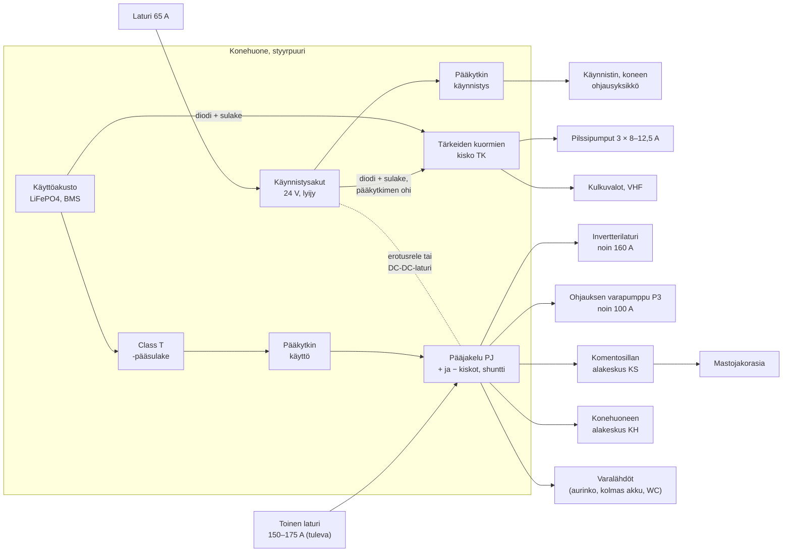

# Sähkönjako: keskukset, sulakkeet ja tärkeiden kuormien syöttö

> **Tila:** Selvitys, aloitettu 2026-10-29, päivitetty 2026-10-30 (pilssipumppujen virrat). Ei päätöstä. Kaapelien pituudet ovat **arvioita**, ja ne
> korvataan veneeltä mitatuilla. Akuston koko, invertteri ja toinen laturi ovat vielä auki
> ([ac-power-source.md](ac-power-source.md), [house-battery.md](house-battery.md)), joten niiden
> lähdöille varataan tässä vain paikka.

Tavoite on päättää jakelun rakenne ennen kaapelointia: mitä keskuksia tulee ja mihin, mitkä
kuormat saavat virran myös vikatilanteessa, miten piirit suojataan ja miten miinus ja teräsrunko
kytketään. Suurin osa tästä ei riipu siitä, minkä kokoinen akusto ja invertteri valitaan.

**Turvallisuus:** pilssipumput, kulkuvalot, VHF ja ohjauksen varapumppu ovat turvallisuuskriittisiä.
Niiden syöttö ja vikatilanteet on kuvattu kohdassa 3. **Koko järjestelmä, erityisesti tärkeiden
kuormien syöttö, miinuksen ja rungon kytkentä sekä 230 V:n puoli, pitää tarkastuttaa pätevällä
sähköasentajalla ennen rakentamista.**

## 1. Lähtötiedot

| Kohde | Arvo | Lähde |
|---|---|---|
| Järjestelmäjännite | 24 V | [vessel/README.md](../../vessel/README.md#sähköjärjestelmän-perustiedot) |
| Akkujen paikka | Konehuoneen styyrpuuri; myös uusi käyttöakusto mahtuu konehuoneeseen | [current-system.md](../current-system.md#1-dc-järjestelmä), [house-battery.md](house-battery.md) |
| Käynnistysakut | 2 kpl, syöttävät nyt kaikki kuormat; tyyppi ja kapasiteetti **⚠ ei tiedossa** | [omistaja 2026-10-29] |
| Käyttöakusto | Ei ole; selvityksessä noin 16 kWh LiFePO4, mahdollisesti kahtena 8S-akkuna | [house-battery.md](house-battery.md) |
| Suurimmat DC-virrat | Invertteri noin 160 A jatkuva (huippu yli 300 A), ohjauksen varapumppu P3 noin 100 A tai yli, toinen laturi 150–175 A | [ac-power-source.md](ac-power-source.md#22-huipputeho-ja-invertteri-laskelma), [hydraulics/schematic.md](../../hydraulics/schematic.md) |
| Kuormat | 24 V:n ja 230 V:n kuormat tehoineen | [loads.yaml](../loads.yaml), [current-system.md](../current-system.md#3-suuret-dc-kuormat) |
| Kone | CAT 3126B, kiinnitetty jäykästi runkoon | [vessel/README.md](../../vessel/README.md#voimansiirto) |
| Maasähkö | 15 A, erotusmuuntaja Airlink WM5002 (olemassa, ei kytketty) | [ac-power-source.md](ac-power-source.md#26-olemassa-oleva-erotusmuuntaja-airlink-wm5002) |

## 2. Ehdotettu rakenne

Kolme tasoa: **pääjakelu** akkujen vieressä, **alakeskukset** siellä, missä kuormat ovat, ja
**tärkeiden kuormien kisko**, joka saa virran kummaltakin akustolta.

Kaavio on periaatekuva. Laturien, CTEK:n ja invertterilaturin tarkat kytkennät ratkeavat, kun
laitteet valitaan.

### 2.1 Pääjakelu (PJ), konehuone

Pääjakelu tulee akkujen viereen, jotta suurivirtaiset kaapelit jäävät lyhyiksi. Siinä on vain
suuria lähtöjä ja alakeskusten syötöt. Arkikäytössä siihen ei kosketa.

| Lähtö | Virta | Huomiot |
|---|---|---|
| PJ-01 Invertterilaturi | noin 160 A jatkuva, huippu yli 300 A [ac-power-source] | Oma sulake; kaapeli ja sulake valmistajan ohjeen mukaan (**⚠ tarkista** valitun laitteen käyttöohjeesta) |
| PJ-02 Ohjauksen varapumppu P3 | noin 100 A tai yli; käynnistysvirta suurempi **⚠ ei tiedossa** | Turvallisuuskriittinen, ks. kohta 3. Moottorin tyyppikilpi **⚠ tarkista** |
| PJ-03 Toinen laturi | 150–175 A (tuleva) | Kytkentä ja sulake laturin ohjeen mukaan; varaa paikka nyt |
| PJ-04 Komentosillan alakeskus | mitoitus noin 60 A **⚠ arvio** | Kaikki valot yhtä aikaa noin 46 A [current-system 3.2] ja elektroniikka |
| PJ-05 Konehuoneen alakeskus | mitoitus noin 40 A **⚠ arvio** | Pumput, tietokoneet, Mean Well -muuntimet, hydrauliikan ohjaus |
| PJ-06 Tärkeiden kuormien kisko | ks. kohta 3 | Lisäksi syöttö käynnistysakuilta |
| PJ-07–08 Varalähdöt | – | Aurinkosäädin, kolmas akku tai polttava WC ([house-battery.md](house-battery.md#suositus-ei-päätös)) |

**Shuntti** (akkumonitori) tulee käyttöakuston miinukseen niin, että kaikki kuormat ja laturit
kulkevat sen kautta. Muuten kulutusta ei voi mitata.

### 2.2 Komentosillan alakeskus (KS)

Komentosillalta ohjattavat laitteet [current-system.md 3.2](../current-system.md#32-komentosillalta-ohjattavat-24-vn-laitteet):
sisä-, kansi- ja työvalot, hakuvalo, navigointitietokone, AIS, tutka, kirkasnäkölasi,
pyyhkijät, FM-radio ja huurunpoistopuhallin. Kulkuvalot, ankkurivalo ja VHF kytketään
mieluiten tärkeiden kuormien kiskoon (kohta 3), mutta niiden kytkimet voivat olla samassa
paneelissa.

Mastoon menevät syötöt (valot, tutka) tuodaan **mastojakorasiaan** maston juurelle. Mastoon menee
lisäksi kolme koaksiaalikaapelia, Ethernet ja NMEA 2000 -pudotus
([current-system.md 3.4](../current-system.md#34-maston-ja-katon-varustelu)). Kaikki läpiviennit
ja jakorasia suunnitellaan kerralla.

### 2.3 Konehuoneen alakeskus (KH)

Konehuoneen 24 V:n kuluttajat [current-system.md 3.1](../current-system.md#31-suunnitellut-24-vn-kuluttajat-konehuoneessa):
käyttövesi-, harmaavesi-, kiertovesi- ja siirtopumppu, savukaasupuhallin, LED-valaistus,
puhallinkonvektorit, Mean Well DDR-240B-24 (NUC, NMEA 2000, modeemi, PoE-kamerat) ja
DDR-15G-5 (Raspberry Pi) sekä hydrauliikan ohjaus. Alakeskus voi olla pääjakelun vieressä,
koska kaapelit ovat joka tapauksessa lyhyitä.

**Jatkuvasti päällä olevat** (Signal K, NUC, modeemi, kamerat, NMEA 2000) kannattaa koota omaksi
ryhmäkseen. Silloin ne voidaan sammuttaa yhdellä katkaisimella, kun vene jätetään talveksi.

## 3. Tärkeät kuormat ja vikatilanteet

**Periaate:** tärkeät kuormat eivät saa sammua, jos käyttöakuston BMS katkaisee akuston,
alijännitekatkaisu laukeaa tai pääkytkin käännetään pois. Siksi niille tulee oma kisko (TK),
joka saa virran **sekä käyttöakustolta että käynnistysakuilta** diodien kautta. Diodit estävät
akustoja purkautumasta toisiinsa. Kumpikin syöttö on suojattu omalla sulakkeellaan akun
vieressä, ja käynnistysakkujen syöttö ohittaa pääkytkimen.

Diodiksi kannattaa valita **ideaalidiodi** (MOSFET), koska tavallisen diodin jännitehäviö
pienentää pumppujen ja valojen jännitettä. Tuote **⚠ ei valittu**.

| Kuorma | Syöttö | Miksi |
|---|---|---|
| Pilssipumput SEAFLO 3500 GPH, 3 × 8 A nimellinen, enintään 12,5 A ([loads.yaml](../loads.yaml)) | TK, kukin pumppu omalla sulakkeellaan kohokytkimen kautta; ei PDM:n eikä pääkytkimen takana. Käsin pakotettu käyttö ESP32-PDM:ltä rinnan kohokytkimen kanssa [omistaja 2026-10-30] | Vesivuoto on vaarallisin vika, ja silloin akut voivat olla jo heikkoina. Kohokytkinpiiri toimii, vaikka PDM olisi rikki |
| Kulku- ja ankkurivalot | TK | Pakollinen varuste ajossa ja ankkurissa |
| VHF Sailor RT2048 | TK | Hätäliikenne |
| Pilssihälytys ja yläveden hälytin | TK | Varoittaa, ennen kuin pumput eivät enää riitä. Hälytin **⚠ ei valittu** |
| Ohjauksen varapumppu P3 | Pääjakelu (PJ-02) ja hätärinnankytkin käynnistysakuille | Liian suuri virta (noin 100 A) diodien kautta syötettäväksi; ks. vikatilanteet |
| Koneen ohjausyksikkö ja käynnistys | Käynnistysakut | Kone käynnistyy ja käy, vaikka käyttöakusto olisi tyhjä tai irti. **⚠ tarkista**, mistä koneen ohjausyksikkö nyt saa virtansa |

### 3.1 Vikatilanteet

| Vika | Mitä tapahtuu | Miten varaudutaan |
|---|---|---|
| Käyttöakuston BMS katkaisee (alijännite, ylilämpö, kennovika) | Alakeskukset ja invertteri sammuvat | TK saa virran käynnistysakuilta: pilssipumput, kulkuvalot ja VHF toimivat. BMS:n ennakkovaroitus pysäyttää laturit ennen katkaisua ([ac-power-source.md](ac-power-source.md#25-toisen-laturin-hintataso-haettu-2026-10-28)) |
| Käynnistysakut tyhjenevät tai vioittuvat | Kone ei käynnisty | TK saa virran käyttöakustolta. Kone käynnistetään hätärinnankytkimellä käyttöakustolta (kohta 3.2) |
| P1:n hihna katkeaa ajossa | Ohjauspiirissä ei ole öljyä | P3 käynnistetään. Se ottaa noin 100 A. Tuleva 150–175 A:n laturi lataa käyttöakustoa enemmän kuin P3 kuluttaa, joten P3 voi käydä pitkään. Nykyisellä 65 A:n laturilla akut purkautuvat |
| Kone sammuu ja P3 tarvitaan | P3 käy pelkillä akuilla | 16 kWh:n käyttöakusto riittää P3:lle tunneiksi **⚠ arvio**; nykyiset käynnistysakut paljon lyhyemmin. Hätäohjaus ilman sähköä: [hydraulics/requirements.md](../../hydraulics/requirements.md) |
| P3:n syöttö katkeaa (sulake, BMS) | Varaohjaus ei toimi | Hätärinnankytkin käynnistysakuille (kohta 3.2). P3:n sulakkeen pitää kestää käynnistysvirta laukeamatta; arvo moottorin tyyppikilvestä **⚠ tarkista** |
| Oikosulku TK:n jälkeen | Kiskon sulake palaa, ja kaikki tärkeät kuormat sammuvat | Jokainen tärkeä kuorma omalla sulakkeellaan, jotta yksi vika ei vie muita. Kiskon syöttösulake mitoitetaan suuremmaksi kuin suurin lähtösulake |
| Pilssipumpun kohokytkin jumittuu päälle | Pumppu tyhjentää akkuja | Pumppujen käyntiaika ja virta Signal K:hon, hälytys pitkästä käynnistä. Ehdotus: ESP32-PDM:n pakotetun käytön lähtö näkee pumpun jännitteen myös kohokytkimen käyttämänä ja raportoi käynnit; **⚠ ei päätetty** |
| Diodi vikaantuu poikki | Toinen syöttö puuttuu TK:sta, kukaan ei huomaa | Kummankin syötön jännitteen valvonta Signal K:hon |

### 3.2 Hätärinnankytkin

Hätärinnankytkin yhdistää käynnistysakut ja käyttöakuston käsin. Sillä kone käynnistetään
käyttöakustolta, tai P3 ja TK saavat virran käynnistysakuilta. Normaalisti se on auki.

**Varoitus:** kun täysi litiumakusto ja tyhjä lyijyakku yhdistetään, akkujen välillä voi kulkea
erittäin suuri virta. Kytkin on tarkoitettu vain hätätilanteeseen, eikä sitä jätetä kiinni.
Merkitse se selvästi. Sopivuus valitun BMS:n kanssa **⚠ tarkista** (osa BMS:istä katkaisee
suuren latausvirran takia).

## 4. Sulakkeet ja kaapelit

### 4.1 Periaatteet

1. **Sulake suojaa kaapelia, ei laitetta.** Sulake on kaapelin syöttöpäässä, ja sen arvo on
   enintään kaapelin kuormitettavuus ja vähintään laitteen virta.
2. **Jokainen akulta lähtevä pluskaapeli suojataan sulakkeella mahdollisimman lähellä akkua.**
   ABYC E-11 sallii tyypillisesti noin 18 cm (7") **⚠ tarkista** standardista.
3. **Käyttöakuston pääsulake on Class T** tai muu sulake, jonka katkaisukyky riittää
   LiFePO4-akuston oikosulkuvirralle ([house-battery.md](house-battery.md#3-mitä-itse-koottu-akusto-vaatii-kennojen-lisäksi)).
4. **Vain DC-käyttöön hyväksyttyjä sulakkeita ja katkaisimia.** Monet halvat automaattisulakkeet
   on tehty AC:lle, eivätkä ne välttämättä katkaise DC-virtaa luotettavasti.
5. **Kaikki miinukset johtimella miinuskiskoon.** Runkoa ei käytetä virtajohtimena (kohta 5).
6. **Tinattu monisäikeinen venekaapeli.** Plus punainen, miinus musta tai keltainen
   (**⚠ tarkista** ISO 10133:n värit). Jokainen kaapeli merkitään piirin tunnuksella
   (kohta 4.4) kummastakin päästä.

### 4.2 Jännitehäviö ja kaapelin koko [laskelma]

Kaapelin poikkipinta valitaan suuremmaksi kahdesta:

- **jännitehäviön mukaan:** A = 2 · L · I · ρ / ΔU, jossa L on kaapelin pituus yhteen suuntaan,
  ρ = 0,0175 Ω·mm²/m (kupari, 20 °C) ja ΔU sallittu häviö. Yleinen käytäntö (ABYC,
  **⚠ tarkista**) on **3 %** (0,72 V) tärkeille kuormille, kuten kulkuvaloille, elektroniikalle ja
  pilssipumpuille, ja **10 %** (2,4 V) muille.
- **kuormitettavuuden mukaan:** kaapelivalmistajan taulukosta. Se riippuu eristeen
  lämpöluokasta, ympäristön lämpötilasta (konehuone on kuuma) ja niputuksesta. Lyhyissä
  suurivirtaisissa kaapeleissa tämä ratkaisee.

Esimerkkejä. **Pituudet ovat arvioita** ja korvataan mitatuilla. Kuormitettavuutta ei ole
tarkistettu.

| Piiri | Virta | Pituus yhteen suuntaan (**⚠ arvio**) | Häviö | Laskettu | Vähintään |
|---|---|---|---|---|---|
| PJ-04 Komentosillan alakeskuksen syöttö | 60 A | 6 m | 3 % | 17,5 mm² | 25 mm² |
| PJ-05 Konehuoneen alakeskuksen syöttö | 40 A | 2 m | 3 % | 3,9 mm² | 4 mm², kuormitettavuus ratkaisee |
| Pilssipumppu, kukin (Max Draw) | 12,5 A | 8 m | 3 % | 4,9 mm² | 6 mm² |
| Hakuvalo (komentosillan katto [omistaja 2026-10-30], 250 W [omistaja 2026-10-31]) | 10,4 A | 3 m (KS → katto) | 10 % | 0,5 mm² | 1,5 mm² |
| Hakuvalo, jos halutaan täysi valoteho | 10,4 A | 3 m | 3 % | 1,5 mm² | 2,5 mm² |
| Kansivalaistus | 8,3 A | 10 m | 10 % | 1,2 mm² | 1,5 mm² |
| Työvalo, kumpikin | 4,2 A | 8 m | 10 % | 0,5 mm² | 1,5 mm² |
| Kulku- ja ankkurivalot | alle 0,5 A | 8 m | 3 % | alle 0,2 mm² | 1,5 mm² mekaanisen kestävyyden vuoksi |
| Ohjauksen varapumppu P3 | 100 A | 3 m | 3 % | 14,6 mm² | 16 mm², kuormitettavuus ratkaisee |
| Invertterilaturi | 160 A | 2 m | 3 % | 15,6 mm² | valmistajan ohjeen mukaan; kuormitettavuus ratkaisee |
| Toinen laturi | 175 A | 3 m | 3 % | 25,5 mm² | 35 mm², kuormitettavuus ratkaisee |

**Havainto:** 24 V puolittaa virran 12 V:iin verrattuna, joten kevyet valo- ja
elektroniikkapiirit pärjäävät ohuilla kaapeleilla. Kaapelin koon ratkaisevat komentosillan
syöttö, pilssipumput ja suuret kuormat.

### 4.3 Sulaketyypit ja kustannukset

| Käyttö | Vaihtoehto | Huomiot |
|---|---|---|
| Käyttöakuston pääsulake | Class T | Suuri katkaisukyky |
| Suuret lähdöt (invertteri, P3, laturi, alakeskusten syötöt) | MEGA-, ANL- tai MRBF-sulake (MRBF kiinnitetään suoraan akun napaan) | Halpoja ja luotettavia; vaihto vaatii työkalun |
| Alakeskusten lähdöt, halvin | Lattasulakerasia (ATO/ATC) ja erilliset kytkimet tai PDM | Halvin. Palanut sulake pitää vaihtaa, ja varasulakkeita pitää olla mukana |
| Alakeskusten lähdöt, helpoin | DC-automaattisulakkeet, jotka toimivat myös kytkiminä | Kalliimpia, mutta laukeamisen jälkeen piiri palautetaan napista |
| PDM-lähdöt | Oma ESP32-PDM ([current-system.md 4](../current-system.md#4-valvonta-verkot-ja-tehonjako)) | Ohjaus ja virran mittaus Signal K:hon. **PDM:n edessä on silti sulake**, joka suojaa syöttökaapelin |

**Suositus (ei päätös):** tärkeille kuormille DC-automaattisulakkeet tai sulakkeet ja tavalliset
kytkimet, jotta ne toimivat ilman ohjelmistoa. Muut piirit voi ohjata PDM:llä
lattasulakkeiden takaa. Se on edullista, ja kulutus näkyy Signal K:ssa.

### 4.4 Piirien tunnukset

Ehdotus: keskuksen tunnus ja juokseva numero, esim. `PJ-02` (pääjakelu), `TK-01`
(tärkeät kuormat), `KS-05` (komentosilta), `KH-03` (konehuone), `AC-02` (230 V). Sama tunnus
näkyy kaapelin merkinnässä, keskuksen kyltissä ja tulevassa piirilistassa. Kun piirilista
täydentyy, se kannattaa siirtää `loads.yaml`:iin kenttänä `circuit`.

## 5. Miinus ja teräsrunko

Teräsrungossa miinuksen kytkentä vaikuttaa korroosioon. Tämä kannattaa päättää ennen
kaapelointia.

- **Runkoa ei käytetä virtajohtimena.** Jokaisella kuormalla on oma miinusjohdin miinuskiskoon.
- **Kone on luultavasti jo kytketty runkoon.** Kone on kiinnitetty jäykästi runkoon
  [vessel/README.md](../../vessel/README.md#voimansiirto), ja käynnistinmoottori ja laturi käyttävät
  tavallisesti koneen runkoa miinuksena. Silloin akun miinus on yhteydessä runkoon koneen kautta,
  ellei käynnistin ja laturi ole eristettyä mallia. **⚠ tarkista** veneellä.
- **Jos yhteys on, se saa olla vain yhdessä pisteessä** (yleensä koneen runko tai miinuskisko).
  Muut miinukset eivät saa koskea runkoon, koska rinnakkaiset reitit rungon kautta kuljettavat
  virtaa teräksessä ja syövyttävät sitä.
- **Vaihtoehto:** täysin rungosta eristetty järjestelmä ja eristysvian valvonta. Se vaatii
  eristetyt käynnistimen ja laturin, eli se on kalliimpi ja harvinaisempi.

**Mittaus veneellä:** irrota kaikki kuormat ja maasähkö, ja mittaa resistanssi akun miinuksen ja
rungon välillä. Jos mitattu arvo on lähellä nollaa, yhteys on olemassa. Selvitä sitten, onko yhteys
vain koneen kautta.

**Suositus (ei päätös):** yksi tarkoituksellinen yhteyspiste koneen runkoon. Muut miinukset
viedään eristettyinä miinuskiskoon. Päätös tehdään pätevän sähköasentajan kanssa.

## 6. 230 V:n jakelu

Periaate (laitteet ovat vielä valitsematta):

**maasähköpistoke → johdonsuoja → erotusmuuntaja → invertterilaturin AC-tulo → AC-lähtö →
vikavirtasuoja 30 mA → johdonsuojat → piirit**

- Erotusmuuntaja WM5002 erottaa veneen verkon laiturin suojamaasta, mikä on teräsrungolle
  tärkeää. Toision nollan ja suojamaan kytkentä on vielä varmistamatta
  ([ac-power-source.md 2.6](ac-power-source.md#26-olemassa-oleva-erotusmuuntaja-airlink-wm5002)).
  Siitä riippuu, toimiiko vikavirtasuoja.
- **Ehdotetut piirit:** kiuas (2,3 kW, oma piiri), jääkaappi (oma piiri), keittiö (liesi ja uuni,
  jos sähköiset), pistorasiat, ilmanvaihto ja lämmityksen poltin.
- **Vain maasähköllä toimivat piirit:** vedenlämmittimen 3 kW:n vastus ei kannata akustolta
  ([ac-power-source.md 4](ac-power-source.md#4-suositus-ei-päätös)). Joko invertterilaturissa on
  erillinen maasähkölähtö (**⚠ tarkista** valitusta laitteesta), tai kontaktori kytkee piirin vain,
  kun maasähkö on kytketty.
- **Kuormanhallinta:** kiuas ja vedenlämmitin voidaan pudottaa pois PDM:llä, kun keittiökuorma on
  suuri ([ac-power-source.md 2.2](ac-power-source.md#22-huipputeho-ja-invertteri-laskelma)).
  Kiukaan ja vedenlämmittimen kontaktorien ohjaus tulisi PDM:ltä.

**Suomessa 230 V:n kiinteät asennukset vaativat luultavasti sähköalan ammattilaisen**
(**⚠ tarkista** Tukesista, mitä huviveneessä saa tehdä itse). Omistajat voivat tehdä
suunnittelun ja kaapelireitit, mutta kytkennät ja käyttöönottotarkastus kannattaa sopia
sähköurakoitsijan kanssa ajoissa.

## 7. Mitä voidaan päättää nyt ja mitä myöhemmin

| Voidaan päättää nyt | Odottaa akuston, invertterin ja laturin valintaa |
|---|---|
| Keskusten määrä ja paikat (PJ, KS, KH, mastojakorasia) | Pääsulakkeen arvo ja suurten kaapeleiden koko |
| Tärkeiden kuormien kisko ja niiden syöttö kummaltakin akustolta | BMS:n ohjauskytkennät laturille ja invertterille |
| Miinuksen ja rungon kytkentä | Toisen laturin kiinnike ja kaapelointi |
| Sulaketyypit ja PDM:n rooli | Aurinkosäädin ja kolmas akku (varalähdöt) |
| Piirien tunnukset ja kaapelien merkintä | Vain maasähköllä toimivan piirin toteutus |
| Kaapelireitit ja läpiviennit, myös mastoon | |

## 8. Avoimet kysymykset

- [ ] **Keskusten paikat:** mihin komentosillan alakeskus mahtuu? Onko veneellä vanha keskus tai
  kaapelointia, jota voi käyttää uudelleen?
- [ ] **Kaapelireittien pituudet** suunnilleen metreinä: akut → komentosilta, komentosilta →
  maston huippu, akut → keula ja asuintilat, akut → pilssipumput
- [ ] **Sulaketyyppi:** lattasulakkeet ja PDM (halvempi) vai DC-automaattisulakkeet (helpompi)?
- [ ] **Veneellä:** resistanssi akun miinuksen ja rungon välillä; onko käynnistin ja laturi
  maadoitettu koneen runkoon?
- [ ] **Veneellä:** mistä koneen ohjausyksikkö saa nyt virtansa?
- [ ] **Veneellä:** P3:n moottorin tyyppikilpi (virta, käynnistysvirta jos ilmoitettu)
- [ ] Ideaalidiodin ja hätärinnankytkimen valinta tärkeiden kuormien kiskolle
- [ ] Pilssihälytys ja yläveden hälytin: laite ja liitäntä Signal K:hon
- [ ] Mitkä piirit ohjataan PDM:llä ([current-system.md 5](../current-system.md#5-avoimet-kysymykset))
- [ ] Mitä 230 V:n asennuksesta saa tehdä itse (Tukes) ja kuka sähköurakoitsija tarkastaa
