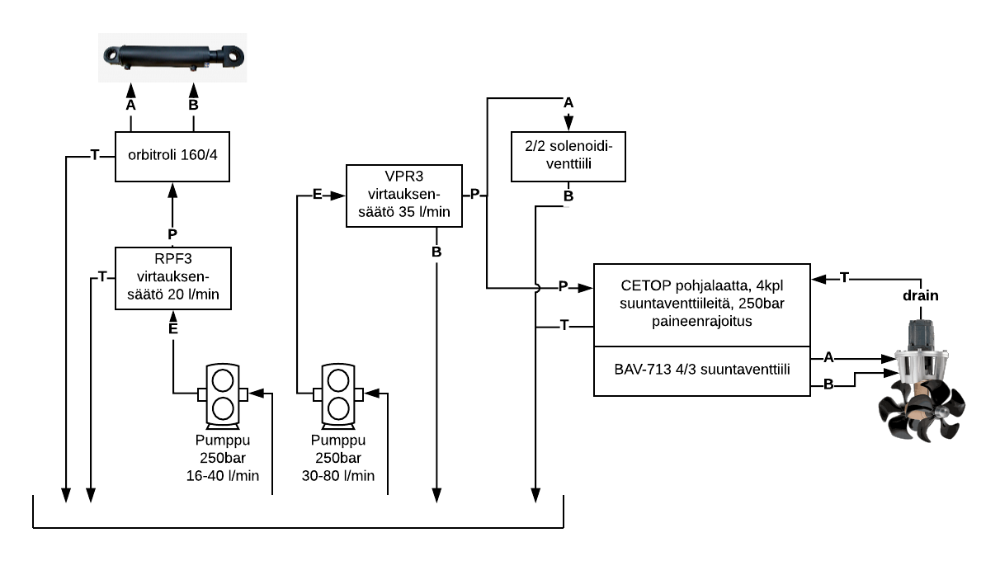

# Vega — hydrauliikan nykytila (lähtötilanne)

> **Tila:** Koottu Plektra-blogista (2016–2021) ja omistajien antamista tiedoista lokakuussa 2026
> (ks. §0). Päivitetty 2026-10-28: P2:n nykyisen 32 mm:n imun täysiaukkoinen palloventtiili jää P1:lle; 50 mm:n palloventtiili P2:lle todennäköisesti jo olemassa **⚠ tarkista veneellä**. 2026-10-27: ankkurivinssissä kahden ketjun ketjuveto ja käsikäyttöinen nauhajarru ketjupyörän akselilla, vapaa pudotus, räikkälukitus ja käsikampi, sähkömoottori korvataan hydraulimoottorilla; U11:n vuotolinja uusiksi suoraan säiliöön, ankkurivinssi ei kytketty (voimansiirto uusiksi); **P2 on Vickers PVH57** (päätös, kaupat sovittu), kytkin HRC 150; venttiileiksi PVG 32 (ykkösvaihtoehto); F1-61-selvitys arkistoitu. 2026-10-26: P2:n valinta (F1-61) on alustava, omistaja kallistuu säätötilavuuspumppuun; säiliön öljypinta vähintään 1 m pumppujen yläpuolella; paluusuodattimen malli OMTF112C10NA2; 2026-10-24: P2 = Parker F1-61 tai vastaava ISO 7653 -vinoakselipumppu ohitusventtiilillä (Torin kauppa peruuntui); 2026-10-23: P2 = Parker F1-61 + BPV-F1, Spidex-kytkin, 50 mm imulinja (alustava päätös); P1:n imulinja 25 mm × 3,2 m ja muutosehdotus ([p1-steering-pump.md](design/p1-steering-pump.md)). Kohdat, joissa on merkintä **⚠ tarkista**, pitää tarkistaa veneellä.
>
> **Hydraulipumput on irrotettu** (lokakuu 2026); muu järjestelmä (säiliö, venttiilit, orbitroli,
> sylinteri, letkut) on paikallaan [omistaja 2026-10-23]. Luvut 3.1–3.5 kuvaavat viimeisintä
> koottua kokoonpanoa (2017–2018); pumppujen veto (3.1–3.2) muuttuu, muu osin käytetään uudelleen.
>
> Lähteet: `[blogi VVVV-KK-PP]` viittaa blogikirjoituksiin (`plektra.github.io/_posts/`),
> `[omistaja VVVV-KK-PP]` omistajien antamiin tietoihin.

## 0. Nykytilanne (omistajien päivitys 2026-10-21)

| Kohde | Tila |
|---|---|
| Vaihteisto | Advance 300 on **asennettu ja linjattu** potkuriakseliin, ja akselille on uusi laakeripukki |
| Pääkone | Asennetaan takaisin ja linjataan vaihteistoon |
| Hydrauliikka | **Molemmat pumput irrotettu**; muu järjestelmä (säiliö, venttiilit, orbitroli, sylinteri, letkut) on paikallaan [omistaja 2026-10-23]. Pumppuja ei asenneta ennen kuin kone on linjattu. |
| Suunnitelma: ohjauspumppu | Pieni vakiotilavuuspumppu (P1, 16,6 cm³) palaa koneen etupäähän, kahden kiilahihnan vetämänä kuten ennenkin. **Vain ohjaukselle.** |
| Suunnitelma: apupiirin pumppu | **Vickers PVH57** (PVH57C-LAF-1S-10-C12V-31, 57,4 cm³, säätötilavuuksinen aksiaalimäntäpumppu, LS-säädin, pyörimissuunta L) **suoraan Advance 300:n voimanulosotosta (PTO)** omalla SAE C -kannakkeella [päätös 2026-10-27, kaupat sovittu; ks. [p2-variable-pump.md](design/p2-variable-pump.md)]. Venttiileiksi **Danfoss PVG 32** -proportionaaliventtiilipöytä (ykkösvaihtoehto, päätös 2026-10-27, kaupat toteutumassa), ks. [aux-circuit-ls-clean-sheet.md](design/aux-circuit-ls-clean-sheet.md). (Aiempi alustava suunnitelma Parker F1-61 + BPV on arkistoitu: [archive/p2-pump-options.md](design/archive/p2-pump-options.md).) |
| Advance 300:n PTO | **Välitys 1:1, käyttö ensiöakselilta** (pyörii aina kun kone käy, myös vapaalla). **Ei omaa kytkintä.** Nimellisteho **0,044 kW/rpm**, eli vakiomomenttiraja **≈ 420 Nm** (35 kW 800 rpm:llä, 110 kW 2500 rpm:llä). Ulostulo on **sileä Ø48 mm:n kiila-akseli** ilman pumppulaippaa. |
| Suunnitelma: PTO-voimansiirto | PTO-akseli → **HRC 150 -joustokytkin** (Taper Lock 2012 -holkit 48 mm / 1 1/4") → P2 [päätös 2026-10-27, korvaa Spidex 48/60:n]. Pumppu on **omalla, runkoon kiinnitetyllä kannakkeella**, joten PTO-akselille ei tule pumpun painoa eikä sivukuormaa. **Ei PTO-kytkintä** [päätös 2026-10-23]. |
| Suunnitelma: tyhjäkierto | PVH57 on ajossa **valmiustilassa** noin 20 barissa lähes nollatuotolla, kun LS-linja on yhteydessä säiliöön (LS-purku 2/2-magneettiventtiilillä tai venttiilien keskiasennossa, kokoonpanosta riippuen). Sähkökatkossa pumppu jää valmiustilaan. **Kotelovuotolinja** omana letkuna säiliöön öljypinnan alle. Ks. [p2-variable-pump.md](design/p2-variable-pump.md#suositus-kaksitiekompensoitu-virtauksensäätö-ja-ls-purku). (BPV-F1 ei enää tarpeen.) |
| Keulapotkurin letkut | **Pääosin valmiit:** 1/2" **SAE 100R2AT / EN 853** -letkut, omistajien mukaan 300 bar, CETOP-venttiileiltä keulapotkurille. A- ja B-linjat **8,5 m kumpikin**. |
| P2:n painelinja | 3/4" letku pumpulta venttiileille. PTO-sijoitus vaatii **3–4 m** letkua. |
| P2:n imulinja | **50 mm** [päätös 2026-10-23; aiemmin 32 mm:n sisähalkaisija, noin 3 m]. Säiliön öljypinta on vähintään noin 1 m pumppujen imuaukkojen yläpuolella [omistaja 2026-10-26]. |
| P1:n imulinja | **25 mm:n sisähalkaisija, 320 cm** [omistaja 2026-10-23]. Riittää lämpimällä öljyllä; kylmällä öljyllä suurilla kierroksilla alittaa Salamin −0,3 barin rajan, ja 5 m:n pituudella 25 mm ei riitä. **Päätös 2026-10-23: 32 mm** (P2:n vapautuva letku), ks. [p1-steering-pump.md](design/p1-steering-pump.md). |
| Apupiirin paluulinja | 3/4" letku, **< 0,5 m**, venttiililohkolta säiliöön (paluusuodattimen kautta) |
| Päätös: järjestelmäpaine | **Pysytään 250 barin luokassa.** Noin 90 %:n keulapotkuriteho hyväksytään kustannusten vuoksi. |

### Suunniteltu voimansiirto

```
                 ┌── 2 kiilahihnaa, 1:1,24 ── P1 16,6 cm³ ── ohjauspiiri (orbitroli + sylinteri)
 CAT 3126B ──────┤
  (etupää)       │
                 └── vauhtipyörä ── Advance 300 ── potkuriakseli
                                    │
                                    └── PTO 1:1, Ø48 kiila ── HRC 150 ────── P2 PVH57 (LS) ──── apupiiri
                                                                  └─ oma kannake ─┘    (keulapotkuri, ankkurivinssi, …)
```

### Mitä tämä tarkoittaa suunnittelulle

1. **P1 hihnavetoisena on hyvä ratkaisu.** Ohjaus toimii pienellä paineella (normaalisti < 50 bar),
   noin 13 l/min 700 rpm:n tyhjäkäynnillä. Hihnat kantoivat tämän kuorman ongelmitta 2017–2018.
2. **Nykyinen 33,5 cm³:n pumppu on liian pieni 1:1-PTO:lle.** 700 rpm:n tyhjäkäynnillä
   [omistaja 2026-10-22] se antaa noin 22 l/min (volumetrinen hyötysuhde 92 %). Se jää alle
   keulapotkurin 60 %:n tehon tarpeen (26,2 l/min) ja selvästi alle 100 %:n tarpeen (33,8 l/min).
   Blogissa todettiin jo 2018, että 1:1-veto tarkoittaa uusia pumppuja.

   | Tyhjäkäynti (PTO 1:1) | Kierrostilavuus 33,8 l/min:lle | Tuotto 2500 rpm:llä | Momentti 264 barilla |
   |---|---|---|---|
   | **700 rpm** (omistajan mukaan) | **52 cm³** | 120 l/min | 245 Nm |
   | 800 rpm | 46 cm³ | 106 l/min | 214 Nm |
   | 1000 rpm | 37 cm³ | 85 l/min | 172 Nm |

   *Oletukset: volumetrinen hyötysuhde 92 %, mekaaninen 90 %.* Käytännössä 250 barin
   paineenrajoituksella **51 cm³:n pumppu** riittää noin 88 %:n työntövoimaan 700 rpm:llä, ks.
   [p2-pump-options.md](design/archive/p2-pump-options.md#herkkyys-tyhjäkäyntikierroksille).
3. **Ensiöakselin PTO pyörii vapaalla.** Juuri sitä keulapotkurin satamakäyttö vaatii.
4. **PTO:n nimellisarvossa on reilusti varaa.** 0,044 kW/rpm vastaa noin 420 Nm. 51 cm³:n pumppu
   250 barilla tarvitsee noin 225 Nm (54 %), eli noin 16,5 kW akselitehoa 700 rpm:llä (PTO:n raja
   700 rpm:llä 30,8 kW). Jopa 280 barin paineenrajoitus vaatisi vain noin 253 Nm (60 %), joten
   painepiikeille jää varaa.
5. **Järjestelmäpaine: 250 barin luokka, tavoite ~90 % työntövoimasta (päätetty).** Täysi teho
   vaatisi moottorilla 264 bar plus linjahäviöt. Omistajat hyväksyvät noin 90 %:n työntövoiman,
   jotta pumppu ja venttiilit voidaan valita yleisestä 250 barin luokasta. Todellisilla
   letkupituuksilla 250 barin paineenrajoitus antaa lämpimänä noin 85–89 %, ks. kohta 9.
6. **Ajon aikana PVH57 on valmiustilassa** [päätös 2026-10-27]. PTO-kytkintä ei ole, joten pumppu
   pyörii aina koneen mukana, mutta LS-linjan ollessa yhteydessä säiliöön se pitää noin 20 barin
   paineen lähes nollatuotolla. Lämpöä syntyy vähän; tarkka valmiustilan häviöteho **⚠ ei tiedossa**
   (kysy Danfossilta). Keulapotkuria käytettäessä pumppu tuottaa vain tarvittavan virtauksen, joten
   kierroslukitusta ei tarvita lämmön takia; pumpun imupaineraja korkeilla kierroksilla ks.
   [p2-variable-pump](design/p2-variable-pump.md#sopivuus-vegaan-laskelma). (Aiemmat suunnitelmat:
   mekaaninen PTO-kytkin ja F1-61 + BPV, ks. [arkisto](design/archive/p2-pump-options.md).)
7. **Voimansiirron vaatimukset:**
   - **Kytkin:** HRC 150, Taper Lock 2012 -holkit 48 mm (PTO) ja 1 1/4" (pumppu); nimellismomentti
     jälleenmyyjien mukaan noin 600 Nm **⚠ vahvista**; mitoittava momentti käyttökertoimineen noin
     430 Nm 250 barissa [laskelma].
   - **LS-purku ja ohjaus** riippuvat valittavasta venttiilikokoonpanosta, ks.
     [p2-variable-pump](design/p2-variable-pump.md), [LS + on/off](design/aux-circuit-ls-onoff.md),
     [PVG 32](design/aux-circuit-ls-clean-sheet.md).
   - **Vikatilat:** sähkökatko → pumppu valmiustilaan, keulapotkuri ei toimi, ks.
     [p2-variable-pump: Vikatilat](design/p2-variable-pump.md#vikatilat).
   - **Linjaus:** vaihteisto on kiinnitetty jäykästi runkoon [blogi 2021-02-08], kuten myös
     pumppukannake. Linjaus kytkimen ja pumpun asennuspiirustuksen toleransseihin **⚠ HRC 150:n
     sallitut virheet luettelosta**. Tarkista linjaus uudelleen koeajon jälkeen.
   - **Tila:** kytkin (halkaisija 150 mm) + pumppu (noin 36 kg). Tarkista tila suhteessa runkoon,
     vaihteistoon ja potkuriakselin laakeriin.
   - **Suojakotelo** pyörivälle kytkimelle on pakollinen.
8. **Nykyiset 1/2":n keulapotkuriletkut riittävät.** 33,8 l/min:llä öljyn nopeus 12,7 mm:n letkussa on
   noin 4,5 m/s, eli painelinjojen tavanomaisen 3–6 m/s:n ohjearvon sisällä. Arvioitu painehäviö
   letkumetriä kohden (vain suora letku, oletuksena ISO VG 46):

   | Öljyn lämpötila | Viskositeetti | Häviö / metri | Häviö 2 × 8,5 m (A + B) |
   |---|---|---|---|
   | 5 °C (kylmäkäynnistys) | ~380 cSt | ~2,9 bar | ~50 bar |
   | 20 °C | ~130 cSt | ~1,0 bar | ~17 bar |
   | 40 °C | 46 cSt | ~0,35 bar | ~6 bar |
   | 60 °C | ~21 cSt | ~0,30 bar | ~5 bar |

   *Vain suora letku; liittimet lisäävät hieman.* Letkut ovat SAE 100R2AT / EN 853. Standardin
   vähimmäistyöpaine 1/2":lle (-08) on noin 275 bar (4000 psi), ja omistajien mukaan näiden letkujen
   merkintä on 300 bar. Kummin tahansa se on yli 250 barin paineenrajoituksen.
   - **Paluulinjan (3/4", < 0,5 m) häviö on merkityksetön:** alle 0,3 bar kylmälläkin öljyllä.
     Säiliön puolella suurin häviö on paluusuodatin.
   - **P2:n painelinja (3/4", 3–4 m) ei ole ongelma.** Noin 33–37 l/min:llä (tyhjäkäynti) nopeus on
     noin 2,1 m/s ja häviö alle 1 bar lämpimänä. Noin 117 l/min:llä (2500 rpm, kytkin päällä) nopeus on noin
     7 m/s ja häviö noin 2–3 bar, mikä on hyväksyttävää.
   - **Käytä pitkissä keulapotkurilinjoissa letkua, älä putkea.** Muualla käytetyn 15×2-tarkkuusputken
     sisähalkaisija on 11 mm. Tällä virtauksella nopeus olisi noin 5,9 m/s ja häviö noin kaksinkertainen
     letkuun verrattuna.
9. **Keulapotkurin odotettu työntövoima lämpimällä öljyllä on noin 85–89 %, hieman alle 90 %:n
   tavoitteen.** Paineenrajoitusventtiili rajaa paineen pohjalaatalla 250 bariin. Venttiilin,
   letkujen ja paluulinjan häviöt vähennetään siitä, joten moottori saa vähemmän. Potkurin momentti
   kasvaa nopeuden neliössä, joten potkuri asettuu hieman pienemmälle kierrosnopeudelle ja ylimääräinen
   virtaus menee paineenrajoituksen yli.

   | Öljyn lämpötila | Potkurin kierrosnopeus | Työntövoima | Teho |
   |---|---|---|---|
   | 5 °C | ~86 % | ~74 % (~180 kg) | ~64 % |
   | 20 °C | ~92 % | ~84 % (~200 kg) | ~77 % |
   | 40 °C | ~94 % | ~88 % (~210 kg) | ~82 % |

   *Oletukset: noin 6 barin häviö venttiilin kummallakin reitillä (P→A ja B→T), mitatut
   letkupituudet ja noin 1,5 bar paluusuodattimessa. 4–10 barin venttiilihäviöillä lämmin tulos on
   85–89 %. **⚠ Hanki BAV-713:n painehäviökäyrä** tarkentamaan tätä. **Virtauksensäätöventtiilin (F1-61-reitillä VPR3) omaa painehäviötä ei ole mukana** (**⚠ ei tiedossa**); vertailukohtana Sun FXDC vie noin 33 l/min:llä noin 8 bar [datalehti Sun FXDC, kuvaajasta luettu 2026-10-26], mikä pienentäisi työntövoimaa arviolta noin 3 prosenttiyksikköä.* Kilot on laskettu asennusohjeen
   240 kg:n suurimmasta työntövoimasta (kevyt käyttö).

   **Malli vahvistettu valmistajan taulukolla:** Side-Powerin mukaan 80 %:n työntövoimaan tarvitaan
   30,2 l/min ja 211 bar, eli virtaus 89 % ja paine 80 % täydestä. Tämä vastaa tässä käytettyä oletusta,
   että potkurin momentti ja työntövoima kasvavat kierrosnopeuden neliössä [datalehti Side-Power SH Series v1.0.0 2017].

   Täyden ~90 %:n saavuttaminen vaatii korkeamman paineenrajoituksen ja enemmän virtausta
   tyhjäkäynnillä, ks. [p2-pump-options.md](design/archive/p2-pump-options.md#paineenrajoituksen-nostaminen-yli-250-barin).
10. **P2:n imulinja: omistajat vahvistivat 32 mm:n sisähalkaisijan (≈ 1-1/4"), mikä riittää.**
    Säiliön ulosotto on samaa kokoa, joten linjassa ei ole 1":n kuristusta. Arvioitu paine pumpun
    imuaukolla 51 cm³:n pumpulla, kun säiliön öljypinta on noin 1 m pumpun yläpuolella (+0,085 bar)
    ja liitinhäviöt ovat noin K = 2,5 (säiliön ulosotto, palloventtiili, kulmat):

    | Öljyn lämpötila | 700 rpm (tyhjäkäynti) | 1000 rpm |
    |---|---|---|
    | 5 °C | **−0,15 bar** | −0,26 bar |
    | 15 °C | −0,03 bar | −0,09 bar |
    | 20 °C | 0,00 bar | −0,04 bar |
    | 40 °C | +0,05 bar | +0,03 bar |

    Hammaspyöräpumput vaativat yleensä, että imupaine on vähintään noin −0,2…−0,3 bar (ylipaine).
    **Tarkista valitun pumpun datalehdestä.** 32 mm:n linja pysyy tämän sisällä tyhjäkäynnillä noin
    5 °C:een asti. (1":n linjalla vastaava arvo olisi ollut noin −0,5 bar, joten 32 mm oli oikea
    valinta.) Kylmänä kannattaa silti kytkeä pumppu tyhjäkäynnillä.
    Lähtö satamasta on kriittisin tilanne: keulapotkuria tarvitaan heti käynnistyksen jälkeen, kun
    öljy on konehuoneen lämpöistä. HV-luokan öljy antaa lisää marginaalia.

    2500 rpm:llä virtaus olisi niin suuri, että kytkimen pitää silti irrota automaattisesti noin
    1000–1200 rpm:n yläpuolella.

    **Päivitys 2026-10-27:** P2 on PVH57; sen mobiiliversio sallii 2400 rpm imupaineella 0 bar, ja
    50 mm:n imulinja säilyy, ks. [p2-variable-pump](design/p2-variable-pump.md#sopivuus-vegaan-laskelma).
    Alla olevat F1-päivitykset ovat taustaa.

    **Päivitys 2026-10-23:** Parkerin F1-luettelon mukaan imupaineen pitää olla vähintään 1,0 bar
    absoluuttista (noin 0 bar ylipainetta), ja F1-61:lle suositellaan 50 mm:n imuliitintä. Nykyinen
    32 mm:n linja ei täytä tätä kylmällä öljyllä edes tyhjäkäynnillä (noin −0,2 bar 5 °C:ssa VG 46:lla).
    **Päätös 2026-10-23: 50 mm:n imulinja** (korvaa 2026-10-22:n 32 mm:n päätöksen). HV 32 -öljy on
    edelleen suositus.

    **Päivitys 2026-10-22:** Parker F1-061:llä (59,5 cm³) imuvirtaus on suurempi. **Suositus: 38 mm:n
    imulinja mahdollisimman lyhyenä (~2 m) ja HV 32 -öljy**, jolloin imupaine pysyy noin 0 barissa
    vielä 1000 rpm:llä ja 5 °C:ssa. Vertailu ja kierroslukuanalyysi:
    [p2-pump-options.md](design/archive/p2-pump-options.md#imupuoli-letkun-koko-ja-pituus-sekä-öljylaatu).
11. ~~BPV syöttöasennossa korkeilla kierroksilla~~: ei koske PVH57:ää (päätös 2026-10-27). PVH57:n
    imupaine täydellä iskulla 2400 rpm:llä ks. [p2-variable-pump](design/p2-variable-pump.md#sopivuus-vegaan-laskelma).

## 1–2. Alus ja voimansiirto

Siirretty yhteiseen [alustiedostoon](../vessel/README.md), jossa on myös muiden järjestelmien
tarvitsemat sähköjärjestelmän perustiedot.

## 3. Hydraulijärjestelmän yleiskuvaus

Alkuperäinen "traktorijärjestelmä" (hihnavetoinen pumppu omalla säiliöllään, orbitroli,
suuntaventtiili ja vuotava sylinteri) korvattiin 2017 **kahden piirin järjestelmällä**
[blogi 2017-04-01]:

- **Piiri 1 — Ohjaus:** pieni pumppu → kolmitievirtauksensäätöventtiili (vakiovirtaus orbitrolille) → orbitroli → ohjaussylinteri.
  Piirissä on tarkoituksella vain peräsin, turvallisuussyistä.
- **Piiri 2 — Apupiiri:** iso pumppu → virtauksensäätö → vapaakiertoventtiili → CETOP 3 -pohjalaatta
  → keulapotkuri (myöhemmin myös ankkurivinssi ja muut kuormat).
- **Varajärjestelmä:** 24 V:n sähköpumppu, joka syöttää ohjauspiiriä vastaventtiilin kautta.
- **Vaihteiston kytkinhydrauliikka** on erillinen piiri, eikä se kuulu tähän.



*Kaavio v3 blogista (2018). Suunniteltu uusi kokoonpano: [schematic.md](schematic.md).*

### 3.1 Pumppujen veto (tilanne 2018)

| Kohde | Arvo | Lähde |
|---|---|---|
| Veto | Kiilahihnat (Optibelt Super X-Power) kampiakselilta tukilaakeriyksikön kautta kahdelle peräkkäiselle pumpulle | [blogi 2017-07-04] |
| Hihnapyörä / välitys | 180 mm:n hihnapyörä; kone:pumppu = 1:1,24 | [blogi 2017-07-04] |
| Pumppujen kiinnitys | 10 mm:n teräskannake pultattuna koneeseen, 10.9-pultit | [blogi 2017-07-04] |
| **Tunnettu rajoitus** | Hihnat luistavat apupumpulla yli **~160 barin** (~9 kW). Ei turvallinen jatkuvaan käyttöön. | [blogi 2018-11-12] |
| Suunniteltu korjaus (2018) | Pumput koneen eteen kardaaniakselilla (1:1), mikä vaatisi uudet pumput | [blogi 2018-11-12] |
| Suunniteltu korjaus (2021) | Iso pumppu uuden vaihteiston PTO:lle | [blogi 2021-02-08] |
| Päätös (2026) | P1 etupään hihnoille (vain ohjaus), P2 vaihteiston PTO:lle. Etupään kardaaniajatuksesta luovuttiin. | [omistaja 2026-10-21] |

### 3.2 Pumput

| Pumppu | Merkki | Kierrostilavuus | Arvot (kaavio) | Tuotto koneen 800 / 1800 / 2500 rpm:llä* | Syöttää |
|---|---|---|---|---|---|
| P1 | Salami **2PE16D-P28P1** (ryhmä 2, kartioakseli 1:8, laippa P1) | 16,6 cm³/r | 250 bar jatkuva / 280 ajoittainen / 300 huippu; **max 3000 rpm**, min 400 rpm [datalehti Salami 2PE] | 16,5 / 37,1 / 51,5 l/min | Ohjaus |
| P2 | Salami **3PB33D-P38P2**, hammaspyörä (ryhmä 3) | 33,5 cm³/r | 250 bar, 30–80 l/min | 33,2 / 74,8 / 103,8 l/min | Apupiiri (liian pieni PTO:lle, ks. §0) |
| P3 | Vanhasta voimayksiköstä; moottori 24 V, 2,5 kW | **⚠ ei tiedossa** | | | Varaohjaus |

\* Laskettu hihnavälityksellä 1:1,24 ja 100 %:n volumetrisella hyötysuhteella. Koneen 2500 rpm:llä
pumput pyörivät noin 3100 rpm. **P1:n (2PE16D) suurin sallittu kierrosnopeus on 3000 rpm**
[datalehti Salami 2PE], eli hihnavetoisena koneen kierrokset saavat olla enintään noin **2420 rpm**.
Koneen suurin kierrosluku on noin **2400 rpm** [omistaja 2026-10-22], jolloin P1 pyörii noin 2980 rpm:
**juuri ja juuri rajan sisällä**. **Välitystä ei muuteta** (päätös 2026-10-23); pienempi välitys
(esim. 1:1,15 → noin 2760 rpm) antaisi marginaalia, ja ohjaukselle riittäisi silti noin 12 l/min
tyhjäkäynnillä. (Tämän dokumentin muut 2500 rpm:n laskelmat ovat varovaisia arvioita, jotka pätevät
myös 2400 rpm:llä.) Salamin 2PE-sarjan käyttöehdot: imupaine 0,7–2,5 bar absoluuttista,
viskositeetti vähintään 12 cSt (suositus 17–65 cSt, käynnistys enintään 800 cSt), öljy −15…+85 °C
(NBR-tiivisteet).

### 3.3 Piiri 1 — Ohjaus

| Komponentti | Tiedot | Huomiot |
|---|---|---|
| Virtauksensäätö | RPF3 (Marchesini, kolmitie, ylimäärä suoraan säiliöön), asetus 20 l/min. Suurin tulovirtaus 50 l/min (3/8") tai 85 l/min (1/2"), 350 bar [datalehti RPF3]; **koko 1/2"** [omistaja 2026-10-23]: kestää P1:n suurimman tuoton (~49 l/min) | Tyhjäkäynnillä pumppu antaa ~16,5 l/min, joten kaikki menee orbitrolille |
| Ohjausyksikkö | **M+S Hydraulic HKUS 160/4**: 158,4 cm³/r, avoin keskiasento, ei kuormantakaisinkytkentää; **sisäänrakennettu paineenrajoitus** (asetus 80–170 bar) ja iskuventtiilit (140–220 bar); nimellisvirtaus 16 l/min; **T-linjan suurin jatkuva paine 25 bar** [datalehti HKUS] | Paluulinjan vastapaine (esim. öljynjäähdytin ja sen ohitusventtiili) pitää pysyä alle 25 barin |
| Sylinteri | **ZS60350100**, kaksitoiminen: männän Ø 60 mm, varren Ø 35 mm, isku 100 mm [omistaja 2026-10-23]. Pinta-alat 28,3 / 18,7 cm², tilavuudet 283 / 187 cm³, orbitrolin kierroksia laidasta laitaan noin 1,8 / 1,2; voima 50 barilla noin 14 / 9 kN [laskelma] | Kiinnitetty alkuperäiseen reikään lähellä peräsinakselia. Ei aivan yllä paapuurin ääriasentoon, ja reikä on hieman väljä. Saatetaan vaihtaa pidempään [blogi 2017-07-04]. |
| Painemittari (1G1) | Analoginen, P-linjan alussa heti RPF3:n CF-lähdön jälkeen (orbitrolin P-paine) [omistaja 2026-10-23] | Lisämittaukset: [pressure-monitoring.md](design/pressure-monitoring.md) |
| Hätäohitus | Käsiventtiili A- ja B-linjan välissä sylinterin vieressä, irrotettavaa hätäpinnaa varten | [blogi 2017-07-04] |
| Työpaine | Normaalisti < 50 bar | [blogi 2017-07-04] |
| Paineenrajoitus | Orbitrolin sisäänrakennettu paineenrajoitus (säätöalue 80–170 bar). **Säädetään käyttöönotossa**, nykyistä asetusta ei tarvitse selvittää [omistaja 2026-10-23] | [datalehti HKUS] |
| Varasyöttö | P1 ja P3 yhdistyvät T-haarassa, **kumpikin oman vastaventtiilinsä kautta**, RPF3:n tuloon [omistaja 2026-10-23] | P3 on kytketty. 65 A:n laturi ei jaksa syöttää sitä pitkään. |
| Painelinjat | **1/2"** koko piirissä 1 [omistaja 2026-10-23] | |
| Imulinja | **25 mm, 320 cm**; P1:n imuaukko **3/4"** [omistaja 2026-10-23]; Salamin raja −0,3 bar ylipainetta. Laskelma ja ehdotus 32 mm:n linjasta: [p1-steering-pump.md](design/p1-steering-pump.md) | Koko tuotto kulkee imuletkun läpi (RPF3:n ylimäärä palaa säiliöön) |
| Ilmaus | Ei ilmausruuveja; sylinterin liitännät sivuilla | Vaikea ilmata [blogi 2017-07-04] |

### 3.4 Piiri 2 — Apupiiri

| Komponentti | Tiedot | Huomiot |
|---|---|---|
| Virtauksensäätö | VPR3 (Marchesini, kolmitie-prioriteettiventtiili), asetus 35 l/min, ylimäärä B-portista säiliöön. Suurin tulovirtaus 60 / 80 / 120 / 200 l/min (3/8" / 1/2" / 3/4" / 1"), 350 bar [datalehti VPR3] | **Koko 3/4"** [omistaja 2026-10-23]: tulovirtaus enintään 120 l/min, säädetty enintään 100 l/min |
| Vapaakiertoventtiili (keulapotkurin päälle/pois) | Bosch Rexroth OD15-X-17-Y-S0 -patruunaventtiili, 2/2, jännitteettömänä auki, esiohjattu istukka; 350 bar, 2–70 l/min [datalehti RE 18323-07]. **Kytkee paineen CETOP-pohjalaatalle** [omistaja 2026-10-22]. **Omassa erillisessä rungossaan** [omistaja 2026-10-23]: jännitteettömänä auki, jolloin virtaus ohjautuu venttiilin kautta T-linjaan ja säiliöön; jännitteellisenä kiinni, jolloin virtaus ohjautuu CETOP-lohkolle. | Jännitteettömänä P2:n tuotto menee matalalla paineella säiliöön; jännitteellisenä venttiili sulkeutuu ja paine menee BAV-713:lle. Ohjataan päälle aina, kun keulapotkuria käytetään kumpaan tahansa suuntaan. |
| Pohjalaatta | **Flowfit CETOP 3 / NG6, 4-paikkainen, rinnankytketty**, paineenrajoitusventtiilin paikalla (kavitetti P→T) ja painemittariliitännällä. Liitännät: **P ja T 1/2" BSP, A ja B 3/8" BSP**, G (mittari) 1/4" BSP. Pituus 247,7 mm, paino 8,21 kg. **Materiaali teräs** [omistaja 2026-10-22]. Painearvoa ei ilmoitettu; teräksiset CETOP 3 -pohjalaatat on tyypillisesti luokiteltu noin 250–350 bariin **⚠ vahvista Flowfitilta** [datalehti Flowfit CETOP 3]. | 1 paikka käytössä (BAV-713), 3 vapaana (ankkurivinssi ym.). A/B-liitännät ovat 3/8", vaikka keulapotkurin letkut ovat 1/2": pieni lisähäviö, sisältyy venttiilihäviön arvioon. |
| Paineenrajoitusventtiili | **Marchesini VMP 3/4"** (V0720), suoratoiminen istukkaventtiili, asetettu 250 bariin. Suurin virtaus **90 l/min**, suurin paine 350 bar. Jousi todennäköisesti 80–300 bar (vastaa aiemmin mainittua 300 baria), 50 bar / kierros [datalehti VMP, omistaja 2026-10-22] | Aiemmin kirjattu "300 bar, 80 l/min" korjattu datalehden mukaan |
| Keulapotkurin suuntaventtiili | **fluiconnecto (Manuli) BAV-IC3-713**, suoraan ohjattu 4/3-solenoidiventtiili, NG6 / CETOP 03, pohjalaatassa; **valitsee pyörimissuunnan** [omistaja 2026-10-22]. Keskiasennossa A, B ja T yhdistetty, P suljettu (moottori pyörii vapaasti). Suurin virtaus **60 l/min**, suurin paine **350 bar**; kelat BAV-SPC3, 12 tai 24 VDC (**⚠ tarkista** jännite) [datalehti fluiconnecto, Teollisuusventtiilit s. 239] | Painehäviökäyrää ei ole luettelossa |
| Painemittari (2G1) | Analoginen, CETOP-pohjalaatalle tulevassa P-linjassa [omistaja 2026-10-23] | Lisämittaukset: [pressure-monitoring.md](design/pressure-monitoring.md) |
| Keulapotkuri | **Side-Power SH240/250TC-U11**: 250 mm:n tunneli, kaksi vastakkain pyörivää potkuria, hydraulimoottori U11. Työntövoima enintään **240 kg** (kevyt käyttö) / **220 kg** (raskas käyttö) [ohje Sleipner 2746 35 2025]; vanhemmassa esitteessä 220 / 200 kg. Hydraulinen teho 14,9 kW, **käyttöaika jatkuva**. Vaihteisto pronssia, öljykylpy omasta säiliöstä (EP 90, säiliö vesilinjan yläpuolelle); joustokytkin moottorin ja vetoakselin välissä. U11:n liitännät: A ja B 3/4" BSP, **vuotolinja 1/4" BSP pakollinen** (ylempi vuotoliitäntä; moottorin kotelo täytetään öljyllä ennen käynnistystä). Vain suorakierteiset liittimet, mieluiten pehmeätiivisteiset; ei kierreteippiä tai -tiivistettä. | Moottorin vuotolinja (1/4") on **kytketty hydrauliikan paluulinjaan** [omistaja 2026-10-23]. Liitoskohta suhteessa jäähdyttimeen ja suodattimeen **⚠ tarkista**; moottorin kotelon suurin sallittu paine **⚠ ei tiedossa** (ei asennusohjeessa) |
| Keulapotkurin tarve (U11) | 60 %: 26,2 l/min × 158 bar · 80 %: 30,2 l/min × 211 bar · **100 %: 33,8 l/min × 264 bar** (≈ 14,9 kW hydraulista) [datalehti Side-Power SH Series v1.0.0 2017] | Prosentit ovat osuus suurimmasta työntövoimasta (100 % ≈ 240 kg asennusohjeen mukaan) |
| Saavutettu (hihnaveto) | ~160–170 bar, mikä riitti kääntämään aluksen laiturissa | [blogi 2018-11-12] |
| Ankkurivinssi | **Ei kytketty**. Vinssissä on **ketjuveto välityksineen kahdella ketjulla** ja **erillinen mekaaninen jarru**: hihna- eli kitkatyyppinen nauhajarru **ankkuriketjupyörän akselilla**, **täysin käsikäyttöinen**. Vinssi **mahdollistaa vapaan pudotuksen**. Siinä on omistajan muistin mukaan myös **räikkälukitus**, jonka varaan ankkuriketjun voi jättää ja joka estää ankkuria putoamasta, jos veto pettää nostossa **⚠ tarkista**. Vinssiin voi kytkeä **kammen käsikäyttöä varten**. Kampi kytketään **erilliselle välitysakselille**, jonka kiinteä pieni hammaspyörä pyörittää ankkuriketjupyörän akselia siihen kiinnitetyn ison hammaspyörän kautta. **Myös moottorin voima välittyy tämän välitysakselin kautta**, joten voimansiirto on: moottori → tukilaakeriyksikkö → ketjuveto → välitysakseli → hammaspyörävälitys → ketjupyörän akseli. Voimanlähteenä on ollut sähkömoottori tukilaakeriyksikön kautta: joko suoraveto tai yksikössä on planeettavaihde **⚠ tarkista**. Sähkömoottori poistetaan ja korvataan hydraulimoottorilla uuden sovitteen kautta; ketjuveto on tarkoitus säilyttää. Moottoriksi selvitetään ylimääräiseksi jäänyt hydraulimoottori **Danfoss OMP 160 (151-0031)** | [blogi 2017-04-01], [omistaja 2026-10-27] |

### 3.5 Säiliö, öljy ja putkisto

| Kohde | Arvo | Lähde |
|---|---|---|
| Säiliö | Flowfit 100 l, saumaton teräs (Flowfit Weldless Steel Tanks, tyyppi A/B/C **⚠ tarkista**), 50×50×5-kulmarautakannakkeilla kaariin. **Syvyys kannesta pohjaan 365 mm** | [blogi 2017-04-01], [datalehti Flowfit], [omistaja 2026-10-27] |
| Öljymäärä | 80 l | [blogi 2017-07-04] |
| Öljyn tyyppi ja luokka | Nykyinen **⚠ ei tiedossa**. Uusi: **HVLP 32** [päätös 2026-10-23], ks. [hydraulic-oil.md](design/hydraulic-oil.md) | |
| Imulinjat | Suunnitelma 2017: 2 × 1" (konepumput) ja 1 × 3/4" (sähköpumppu), kussakin palloventtiili. **2026: P2:n ulosotto on 32 mm:n letkun kokoinen, ja siinä on 32 mm:n täysiaukkoinen palloventtiili (jää P1:lle); P1:n imulinja 25 mm, 320 cm.** | [blogi 2017-04-10], [omistaja 2026-10-22], [omistaja 2026-10-23], [omistaja 2026-10-28] |
| Säiliön kannen komponentit | Virtauksensäätöventtiilit, paluusuodatin, täyttö- ja huohotinkorkki | [blogi 2017-04-10] |
| Paluusuodatin | **OMT OMTF112C10NA2**, 10 µm, säiliön kanteen asennettava, 1" BSP; painemittarillinen, nykyisessä paikassa vaikea lukea. Jälleenmyyjän mukaan 100 l/min, ohitusventtiili 1,7 bar, vaihtoelementti CR112C10R; `C10` = selluloosa, 10 µm nominaalinen **⚠ tarkista** OMT:n luettelosta | [blogi 2017-04-10], [omistaja 2026-10-26], [jälleenmyyjä Phoenix Hydraulics](https://www.phoenixhydraulics.co.uk/omtf112c10na2.html) |
| Putkitus | Pitkät vedot 15×2-tarkkuusteräsputkella, muuten letkut | [blogi 2017-04-01] |
| Öljynjäähdytin | Ei kummassakaan piirissä. **Varalla Bowman EC100** (valumerkintä EC10, koodi 3249-2, 07/88, runko 185 mm; pronssiset päätykannet, ex-Masson-vaihteisto, putket kunnossa), suunniteltu yhteiseen paluulinjaan, ks. [oil-cooling.md](design/oil-cooling.md) | [omistaja 2026-10-22], [omistaja 2026-10-27] |
| Päivätankki (polttoaine) | 150 l, hydraulisäiliön alla | [blogi 2017-04-19] |
| Päätoimittaja | SixTek (hydrauliikkapumppu.fi) | [blogi 2017-04-01] |

### 3.6 Valmistajan vaatimukset keulapotkurin hydrauliikalle [ohje Sleipner 2746 35 2025]

Asennusohjeen mukaan, kun käytössä ei ole Sleipnerin omaa hydraulijärjestelmää:

| Vaatimus | Vegan tilanne |
|---|---|
| Öljynsuodatin | Paluusuodatin on olemassa ✅ |
| **Öljynjäähdytin niin, että öljy pysyy alle 75 °C:n**; suositeltu käyttölämpötila **40–60 °C** | Suunnitteilla Bowman EC100, ks. [oil-cooling.md](design/oil-cooling.md) |
| Venttiilin virtaus- ja painerajat keulapotkurin rajoissa | VPR3 35 l/min ja VMP 250 bar; U11:n 100 %: 33,8 l/min ja 264 bar ✅ |
| **Iskuventtiilit (shock valve) 10–15 % valitun maksimipaineen yläpuolelle**, suojaamaan järjestelmää, jos potkurit jumittuvat | **Poikkeaa, hyväksytty.** BAV-713:ssa ei ole iskuventtiileitä, eikä lohkoa lisätä (päätös 2026-10-23): kelluva keskiasento (A, B, T yhdistetty) ja VMP 250 bar rajaavat painepiikit. |
| Vuotolinja (1/4" BSP, pakollinen, ylempi liitäntä) | Olemassa ✅, kytketty paluulinjaan [omistaja 2026-10-23]. Ohje ei sano, pitääkö sen mennä suoraan säiliöön; kotelon paine pitää pysyä matalana, ks. avoimet kysymykset |
| Ohjaukseen Sleipnerin S-Link-järjestelmä | **Poikkeaa:** Vegalla oma ohjaus solenoidiventtiileillä. Voi vaikuttaa takuuseen; toiminnallisesti tavallinen ratkaisu. |

Moottorin suurinta sallittua painetta ei ilmoiteta suoraan. Asennus- ja käyttöohjeen taulukoissa
U-sarjan moottorit on kuitenkin kaikkialla rajattu **274–275 bariin**: SH240:n U8 ja U10 sekä isomman
SH320:n **U11** (sama moottori kuin Vegalla) saavuttavat suurimman työntövoimansa 274 barissa
[ohje Sleipner 2746 35 2025, ohje Sleipner 6572 6 2025]. U11:n yläraja on siis käytännössä noin
**275 bar** **⚠ vahvista Sleipneriltä**. 280 barin paineenrajoituksella moottorille jäisi linjahäviöiden
jälkeen noin 260–265 bar, eli rajan alle.

**Huolto ennen jokaista kautta** [ohje Sleipner 6572 6 2025]: tarkista vuodot keulapotkurin ympäriltä,
potkurien ja tunnelin kunto ja kiinnitys, puhdista kasvusto, maalaa potkurit ja vaihteisto
antifouling-maalilla (ei anodia, tiivisteitä eikä akselia), **vaihda anodi** joka kausi tai kun puolet
on kulunut, ja tarkista vaihteiston öljysäiliön (EP 90) öljynpinta. Vastakkain pyörivissä malleissa on
vasen- ja oikeakätinen potkuri.

## 4. Tunnetut ongelmat ja opit

1. **Hihnaveto ei kanna keulapotkurin täyttä tehoa.** Hihnat luistavat noin 160 barissa, kun
   keulapotkuri tarvitsee noin 15 kW 264 barilla. Tämä on pääsyy voimansiirron uusimiseen.
2. **Vakiotilavuuspumput vaihtelevalla kierrosluvulla.** Tuotto seuraa koneen kierroksia, ja ylimäärä
   kuristetaan säiliöön. Se tuhlaa tehoa ja lämmittää öljyä, eikä jäähdytintä ole.
3. **Ohjaussylinterin geometria.** Ei yllä paapuurin ääriasentoon, ja kiinnitysreikä on väljä.
4. **Ilmaus on hankalaa.** Ilmauspisteitä ei ole, ja sylinterin liitännät ovat sivuilla.
5. **Sähköinen varapumppu.** 2,5 kW:n moottori ottaa 24 V:lla noin 100 A tai enemmän, mitä 65 A:n
   laturi ei jaksa.
6. **Paluusuodattimen painemittari** on huonosti luettavassa paikassa.

## 5. Avoimet kysymykset

Ratkaistut:

- [x] Pumppujen veto: P1 etupään hihnoille, P2 vaihteiston PTO:lle (suunniteltu; pumput nyt irrotettu)
- [x] Advance 300 asennettu ja linjattu
- [x] Advance 300:n PTO: 1:1, ensiöakseli (pyörii vapaalla), ei omaa kytkintä
- [x] Advance 300:n PTO:n nimellisarvo: 0,044 kW/rpm (≈ 420 Nm)
- [x] PTO:n ulostulo: Ø48 mm:n kiila-akseli ilman laippaa; HRC 150 -joustokytkin runkoon kiinnitetylle pumpulle (päätös 2026-10-27; välillä Spidex 48/60)
- [x] Keulapotkurin paine: 250 barin luokka, ~90 % hyväksytty
- [x] Keulapotkurin letkut: 1/2", 300 bar, A ja B 8,5 m kumpikin
- [x] P2:n painelinja: 3/4" letku, 3–4 m
- [x] P2:n imulinja: 50 mm (päätös 2026-10-23; aiemmin 32 mm, noin 3 m)
- [x] Paluulinja CETOP:n T-liitännästä säiliöön: 3/4", < 0,5 m
- [x] Säiliön öljypinta noin 1 m P2:n imuaukon yläpuolella
- [x] Paineenrajoitusventtiili: Marchesini VMP 3/4", enintään 90 l/min, 350 bar, jousi 80–300 bar (todennäköisesti)

Avoimet:

- [x] Koneen tyhjäkäynti: **oletetaan 700 rpm, ei mitata** (päätös 2026-10-23)
- [x] ~~P2: Parker F1-61 (59,5 cm³) + BPV-F1 käsiohituksella (päätös 2026-10-23)~~ → **P2 on Vickers PVH57** (päätös 2026-10-27)
- [x] P2:n hankinta: Vickers PVH57, kaupat sovittu [omistaja 2026-10-27]
- [x] Apupiirin venttiilikokoonpano PVH57:lle: **PVG 32** ykkösvaihtoehto (päätös 2026-10-27); varalla LS + on/off ja FXDC + LS-purku, ks. [aux-circuit-ls-clean-sheet](design/aux-circuit-ls-clean-sheet.md)
- [x] ~~PTO-kytkin~~: ei kytkintä (päätös 2026-10-23); PVH57 on ajossa valmiustilassa (päätös 2026-10-27)
- [x] Akselikytkin: HRC 150 + Taper Lock 2012 -holkit 48 mm / 1 1/4" (päätös 2026-10-27; korvaa Spidex 48/60:n), ks. [p2-variable-pump](design/p2-variable-pump.md#tarvittavat-osat-pumpun-lisäksi-minimi)
- [ ] Pumppukannake: omistajat suunnittelevat, 10 mm teräslevy, laserleikkaus ja hitsaus [omistaja 2026-10-23]; ei koneistusta (päätös 2026-10-23); **SAE C -nelireikälaippa** ja noin 36 kg:n pumppu, säätövara linjaukseen, HRC 150, suojakotelo; laipan mitat Eatonin asennuspiirustuksesta **⚠**, ks. [p2-variable-pump](design/p2-variable-pump.md#asennusjärjestys)
- [x] Kone ja merivaihde ovat jäykästi runkoon kiinni, joten pumppukannake kiinnitetään runkoon [omistaja 2026-10-23]
- [x] ~~BPV:n ohitustilan lämpö ajossa~~: BPV:tä ei tule (päätös 2026-10-27)
- [ ] PVH57:n valmiustilan häviöteho ajossa: kysy Danfossilta, mittaa ensimmäisellä kaudella
- [ ] Säiliön liitännät: 50 mm:n imu-ulosotto ja täysiaukkoinen palloventtiili (50 mm:n palloventtiili todennäköisesti jo olemassa [omistaja 2026-10-28] **⚠ tarkista veneellä**); PVH57:n kotelovuotolinjan paluu öljypinnan alle
- [x] U11:n vuotolinja: tehdään uusiksi **suoraan säiliöön** (öljypinnan alle), joten paluulinjan vastapaine ei rasita moottorin koteloa [omistaja 2026-10-27]
- [x] PTO:n pyörimissuunta: **vastakkainen koneen pyörimissuuntaan nähden** [omistaja 2026-10-23]; kone pyörii vastapäivään vauhtipyörän päästä katsottuna [datalehti 3126B, 2026-10-24]; PTO-akseli osoittaa perään [omistaja 2026-10-24] → **P2-pumppu on L**. Ennen kiinteäsuuntaisen pumpun ostoa suunta kannattaa varmistaa teippiliuskalla, ks. [vessel: Pyörimissuunnat](../vessel/README.md#pyörimissuunnat). PVH57 on L ✅.
- [x] Valitun pumpun imupaine: PVH57 mobiili 2400 rpm imupaineella 0 bar, 2000 rpm −0,17 bar (Eaton V-PUPI-TM008-E1 s. 7)
- [x] Mitä öljyä järjestelmässä nyt on: **Teboil Hydraulic Lift 32** (ISO VG 32, DIN 51524-3 HVLP, ISO 6743-4 HV) [omistaja 2026-10-27]
- [x] Nykyinen öljy: noin 7 vuotta, alle 200 h, kirkasta [omistaja 2026-10-27]; **käytetään käyttöönoton huuhteluöljynä** (päätös 2026-10-27, ks. [hydraulic-oil](design/hydraulic-oil.md))
- [x] Hydrauliöljyn tyyppi ja luokka: **HVLP 32** (päätös 2026-10-23), ks. [hydraulic-oil.md](design/hydraulic-oil.md)
- [ ] Öljytuote (Teboil 32S / Neste 32 Super, VI); huuhteluöljy vaihdetaan aikaisintaan koeajojen jälkeen [omistaja 2026-10-27]
- [x] BAV-713: fluiconnecto BAV-IC3-713, 60 l/min, 350 bar
- [ ] BAV-713:n painehäviö ~34 l/min:llä (P→A, B→T): ei luettelossa; kysy toimittajalta tai mittaa
- [x] BAV-713:n kelojen jännite: 24 VDC [omistaja 2026-10-23]
- [x] Keulapotkurin iskuventtiilit: ~~lisätään A/B-iskuventtiililohko~~ → **ei lisätä** (päätös 2026-10-23, korvaa saman päivän päätöksen)
- [x] **Tarvitaanko iskuventtiililohko lainkaan?** Ei (päätös 2026-10-23). BAV-713:n keskiasento on kelluva (A, B ja T yhdistetty), ja VMP rajoittaa P-linjan 250 bariin, joten painepiikit ovat jo rajattuja. Omistajien päätettäväksi (ks. [p2-pump-options](design/archive/p2-pump-options.md))
- [x] ~~U11-moottorin suurin sallittu paine~~: ei tarvita, kun paineenrajoitus pysyy 250 barissa; Sleipnerin taulukko näyttää U11:lle 264 bar 100 %:lla [omistaja 2026-10-23]
- [x] Paineenrajoitus pysyy 250 barissa (päätös 2026-10-21, vahvistettu 2026-10-23)
- [x] Onko ankkurivinssi kytketty? Ei; voimansiirto rakennetaan uusiksi [omistaja 2026-10-27]
- [x] Ylimääräiseksi jäänyt hydraulimoottori: **Danfoss OMP 160 (151-0031)**, orbitaalimoottori, kilvessä "160 151-0031 6" [omistaja 2026-10-27]; tuote lopetettu, Danfossin korvaava koodi 151-0614 [hakutulos Danfoss PowerSource ⚠ tarkista]
- [ ] OMP 160:n tekniset arvot datalehdestä: tarkka kierrostilavuus (noin 155,7 cm³ ⚠ tarkista), suurin jatkuva ja hetkellinen paine-ero, kierrosluku ja momentti, akseli (25 mm ⚠ tarkista), laippa, liitännät ja vuotoliitäntä; riittääkö momentti vinssin välityksellä
- [ ] Ankkurivinssin kokonaisvälitys: onko tukilaakeriyksikössä planeettavaihde (pyöritä tuloakselia 10 kierrosta ja laske lähtöakselin kierrokset), kummankin ketjun hammasluvut ja ketjukoko sekä välitysakselin pienen ja ketjupyörän akselin ison hammaspyörän hammasluvut
- [ ] Ankkurivinssin ketjupyörän halkaisija ja ankkuriketjun koko; ankkurin ja ketjun paino
- [ ] Poistettavan sähkömoottorin tyyppikilpi (kW, rpm): mille nopeudelle välitys on suunniteltu
- [x] Ankkurivinssin mekaaninen jarru: hihna-/kitkatyyppinen nauhajarru ankkuriketjupyörän akselilla, täysin käsikäyttöinen; pitää ankkurin, vaikka vetoketju katkeaa [omistaja 2026-10-27]
- [ ] Ankkurivinssin räikkälukitus: vahvista, että se on räikkä (salpa), joka estää ankkurin putoamisen nostossa, ja että ketjun voi jättää sen varaan; miten salpa kytketään irti laskua varten
- [ ] Ankkurivinssin vapaa pudotus: millä kytkimellä ketjupyörä irrotetaan vedosta (pysyvätkö vetoketjut ja moottori paikallaan pudotuksen aikana)
- [x] Ankkurivinssin käsikampi: kytketään välitysakselille, jonka kautta myös moottorin voima kulkee [omistaja 2026-10-27]. Kampi siis pyörii moottorin mukana, jos se jätetään paikalleen
- [ ] Ankkurivinssin vetoketjujen ja ketjupyörien kunto, kiristys ja voitelu; suojakotelo
- [x] Sähköinen varapumppu P3 on kytketty: P1 ja P3 yhdistyvät T-haarassa kumpikin oman vastaventtiilin kautta RPF3:lle [omistaja 2026-10-23]
- [x] P1:n painelinjassa on vastaventtiili ennen T-haaraa [omistaja 2026-10-23]
- [x] Piirin 1 painelinjat 1/2" [omistaja 2026-10-23]
- [x] Ohjaussylinterin malli: ZS60350100 [omistaja 2026-10-23]
- [x] Ohjaussylinterin mitat: männän Ø 60 mm, varren Ø 35 mm, isku 100 mm [omistaja 2026-10-23]
- [ ] Ohjausvarren pituus, peräsimen pinta-ala ja tyyppi
- [ ] Autopilotti (mahdollinen, ohjaa suuntaventtiileillä ohjauspiirissä [omistaja 2026-10-25]): autopilotin merkki, haluttu kääntöaika laidasta laitaan, peräsinkulma-anturi. Kytkentäehdotus: [vaatimukset §10.3](requirements.md#103-autopilotin-liitäntä-ohjauspiiriin)
- [ ] Painepesuri (mahdollinen apupiirin kuorma [omistaja 2026-10-25]): laitteen malli, hydraulimoottorin virtaus ja paine; jatkuvan käytön lämpökuorma, ks. [oil-cooling](design/oil-cooling.md)
- [ ] Nosturi tai jollan daavitti (epätodennäköinen [omistaja 2026-10-25]): tarvitaanko lainkaan
- [x] Orbitroli: M+S HKUS 160/4, sisäänrakennettu paineenrajoitus
- [x] ~~Orbitrolin paineenrajoituksen nykyinen asetus~~: säädetään käyttöönotossa [omistaja 2026-10-23]
- [x] VPR3 3/4", RPF3 1/2" [omistaja 2026-10-23]
- [x] Koneen suurin kierrosluku noin 2400 rpm → P1 noin 2980 rpm (raja 3000 rpm), riittää niukasti
- [x] P1:n hihnavälitys pysyy 1:1,24 (päätös 2026-10-23); imun kannalta pienennyksen vaikutus olisi ollut pieni, ks. [p1-steering-pump.md](design/p1-steering-pump.md)
- [x] P1:n imulinja nyt: 25 mm, 320 cm [omistaja 2026-10-23]
- [x] P1:n imulinja jatkossa: 32 mm (päätös 2026-10-23)
- [x] Säiliön öljypinnan korkeus P1:een nähden: vähintään 1 m [omistaja 2026-10-26]
- [ ] P2:n 50 mm:n ulosotto uuteen kohtaan, jotta 32 mm:n ulosotto jää P1:lle
- [ ] Painemittaus molempiin piireihin: ehdotus digitaalisista antureista (2B2 P2:n lähtö, 1B2 ohjauspaine), mittausliittimistä ja paluulinjan mittarista, ks. [pressure-monitoring.md](design/pressure-monitoring.md)
- [ ] Anturit: öljyn lämpötila ja P2:n imupaine (malli, ESP32/Signal K -liitäntä); P1:n imupaineen mittaus käyttöönotossa
- [x] P1:n imuaukko: 3/4" [omistaja 2026-10-23]
- [x] Venttiilien tehtävät: Rexrothin 2/2-patruunaventtiili kytkee paineen CETOP-pohjalaatalle, BAV-713 ohjaa suuntaa [omistaja 2026-10-22]
- [x] CETOP-pohjalaatta: Flowfit NG6, 4-paikkainen, rinnankytketty, P/T 1/2", A/B 3/8"
- [x] 2/2-venttiili on omassa erillisessä rungossaan, ei pohjalaatan kavitetissa [omistaja 2026-10-23]
- [x] Pohjalaatan materiaali: teräs
- [ ] Pohjalaatan painearvo Flowfitilta: vahvista, että kestää 250 bar (teräs, todennäköisesti 250–350 bar)
- [x] ~~VMP:n nykyinen asetus~~: säädetään käyttöönotossa 250 bariin [omistaja 2026-10-23]
- [ ] **Käyttöönoton säädöt:** VMP 250 bariin painemittarilla (2G1) keulapotkuri jumitettuna tai BAV-713 ääriasennossa; orbitrolin paineenrajoitus pienimpään arvoon, jolla peräsin kääntyy ääriasentoihin ajossa, kuitenkin enintään sylinterin ja letkujen painearvon
- [ ] Öljynjäähdytys: Bowman EC100 paluulinjaan, merivesi koneen piiristä (malli vahvistettu EC100:ksi [omistaja 2026-10-27]; vetojen määrä ⚠, ks. [oil-cooling.md](design/oil-cooling.md#avoimet-kysymykset))
- [ ] Muutokset vuoden 2021 jälkeen, joita blogi ei kata
