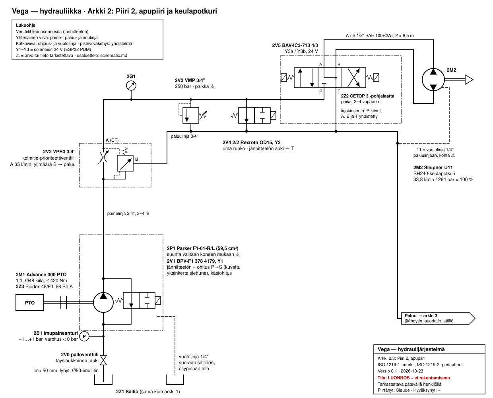
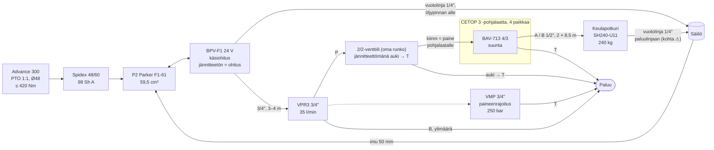

# Arkistoitu kaavio: arkki 2 F1-61-kokoonpanolla

> **🗄 ARKISTOITU 2026-10-27.** Apupiirin kaavio Parker F1-61 + BPV -kokoonpanolle (alustava päätös
> 2026-10-23), joka korvattiin: P2 on Vickers PVH57 ja venttiileiksi Danfoss PVG 32
> ([decisions.md](../../../decisions.md)). Voimassa oleva kaavio: [schematic.md](../../schematic.md).
> Sisältö siirretty sellaisenaan; linkit korjattu uuteen sijaintiin.
>
> - Arkki 2 (F1-61): [img/archive/schematic-2-auxiliary-f1-61.svg](../../img/archive/schematic-2-auxiliary-f1-61.svg)
> - Arkki 3 ennen 2026-10-27:n merkintämuutoksia: [img/archive/schematic-3-return-cooling-f1-61.svg](../../img/archive/schematic-3-return-cooling-f1-61.svg)

### Arkki 2: Piiri 2, apupiiri ja keulapotkuri

| Tunnus | Osa | Tiedot | Lähde |
|---|---|---|---|
| 2M1 | Advance 300 PTO | 1:1, Ø48 mm kiila-akseli, ≤ 420 Nm; pyörii vastakkaiseen suuntaan kuin kone | [current-system §0](../../current-system.md), [omistaja 2026-10-23] |
| 2Z3 | Spidex 48/60 -kynsikytkin | hammaskehä 98 Sh A | [päätös 2026-10-23](../../../decisions.md) |
| 2P1 | Parker F1-61 | 59,5 cm³/r, 350/400 bar; suunta R/L valitaan koneen suunnan mukaan **⚠** | [p2-pump-options](p2-pump-options.md) |
| 2V1 | Parker BPV-F1 378 4179, Y1 | jännitteetön = ohitus (pumppu kiertää tyhjänä), käsiohitus; vuotolinja 1/4" suoraan säiliöön; kaaviossa yksinkertaistettu 2/2-venttiilinä | [p2-pump-options](p2-pump-options.md#lisävaruste-parker-bpv-f1--ohitusventtiili) |
| 2V0 | Imulinjan palloventtiili | täysiaukkoinen; imu 50 mm, Ø50-imuliitin | [päätös 2026-10-23](../../../decisions.md) |
| 2B1 | Imupaineanturi | −1…+1 bar, varoitus alle 0 bar | [päätös 2026-10-23](../../../decisions.md) |
| 2V2 | Marchesini VPR3 3/4" | kolmitie-prioriteettiventtiili, A 35 l/min, ylimäärä B → paluu | [omistaja 2026-10-23], [datalehti VPR3] |
| 2G1 | Painemittari, analoginen | CETOP-pohjalaatalle tuleva P-linja | [omistaja 2026-10-23] |
| 2V3 | Marchesini VMP 3/4" | paineenrajoitus 250 bar (säädetään käyttöönotossa); paikka P-linjassa **⚠ tarkista** | [datalehti VMP] |
| 2V4 | Rexroth OD15 2/2, Y2 | omassa rungossaan; jännitteetön auki → T, jännitteellinen kiinni → paine pohjalaatalle | [omistaja 2026-10-23] |
| 2Z2 | Flowfit CETOP 3 -pohjalaatta | 4 paikkaa, 1 käytössä; teräs; painearvo **⚠** | [omistaja 2026-10-22] |
| 2V5 | fluiconnecto BAV-IC3-713, Y3a/Y3b | 4/3, keskiasento P kiinni, A–B–T yhdistetty; 24 V | [omistaja 2026-10-23] |
| 2M2 | Sleipner U11 / SH240 | 100 %: 33,8 l/min, 264 bar; A/B 1/2" SAE 100R2AT 2 × 8,5 m; vuotolinja 1/4" | [ohje Sleipner 2746 35 2025] |

**Arkkeja 2 ja 3 piirtäessä esiin tulleet asiat:**

- Vuotolinjat (BPV ja U11) on piirretty suoraan säiliöön öljypinnan alle. BPV:lle Parker vaatii
  tämän; U11:n vuotolinja on nyt paluulinjassa, ja liitoskohta pitää tarkistaa.
- VMP:n paikka P-linjassa (VPR3:n ja 2/2-venttiilin välissä?) **⚠ tarkista**.
- Arkki 2: P2:n lähtöpaineanturia (vaatimuksissa ehdotettu) ei ole piirretty, koska siitä ei ole päätetty.

## 2. Apupiiri: PTO-pumppu ja keulapotkuri

Pohjalaatan paikat 2–4 ovat vapaana (esim. ankkurivinssi).

## Toimintatilat (apupiiri)

| Tila | BPV-F1 | 2/2-patruunaventtiili | BAV-713 | Mitä tapahtuu |
|---|---|---|---|---|
| Ajo | jännitteetön (ohitus) | jännitteetön, auki | keskellä | P2 pyörii mutta kiertää tyhjänä pumpun päädyssä; pieni jäähdytysvirtaus vuotolinjan kautta säiliöön (lämpö **⚠ ei tiedossa**) |
| Keulapotkuri valmiina (tyhjäkäynti) | jännitteellinen (vaihdettu 2/2:n ollessa auki, < 20 bar) | jännitteetön, auki | keskellä | P2:n öljy kiertää matalalla paineella säiliöön (~0,7 kW) |
| Keulapotkuri käytössä | jännitteellinen | jännitteellinen, kiinni | a tai b | Paine nousee pohjalaatalla; VPR3 rajaa virtauksen 35 l/min:iin; potkuri saa ~88 % työntövoimasta (~210 kg) |
| Kierroslukitus (> ~1000 rpm) | pakotetaan jännitteettömäksi (2/2 ensin auki) | pakotetaan jännitteettömäksi | estetty | Pumppu ohitukseen; hälytys, jos syöttö päällä yli ~1200 rpm |
| Sähkökatko | ohitus | auki | keskellä | Keulapotkuri ei toimi; käsiohitus vain kone sammutettuna |

## Avoimia kohtia kaaviossa (2026-10-26)

- VMP:n fyysinen paikka P-linjassa (VPR3:n P-portin ja pohjalaatan välissä?) **⚠ tarkista**
- ~~2/2-venttiilin paikka~~: omassa erillisessä rungossaan [omistaja 2026-10-23]
- ~~Varapumpun P3 kytkentä~~: P1 ja P3 yhdistyvät T-haarassa kumpikin oman vastaventtiilin kautta RPF3:lle [omistaja 2026-10-23]
- Öljynjäähdytin ja merivesihaara ovat suunnitteilla; iskuventtiileitä ei lisätä (päätös 2026-10-23)
