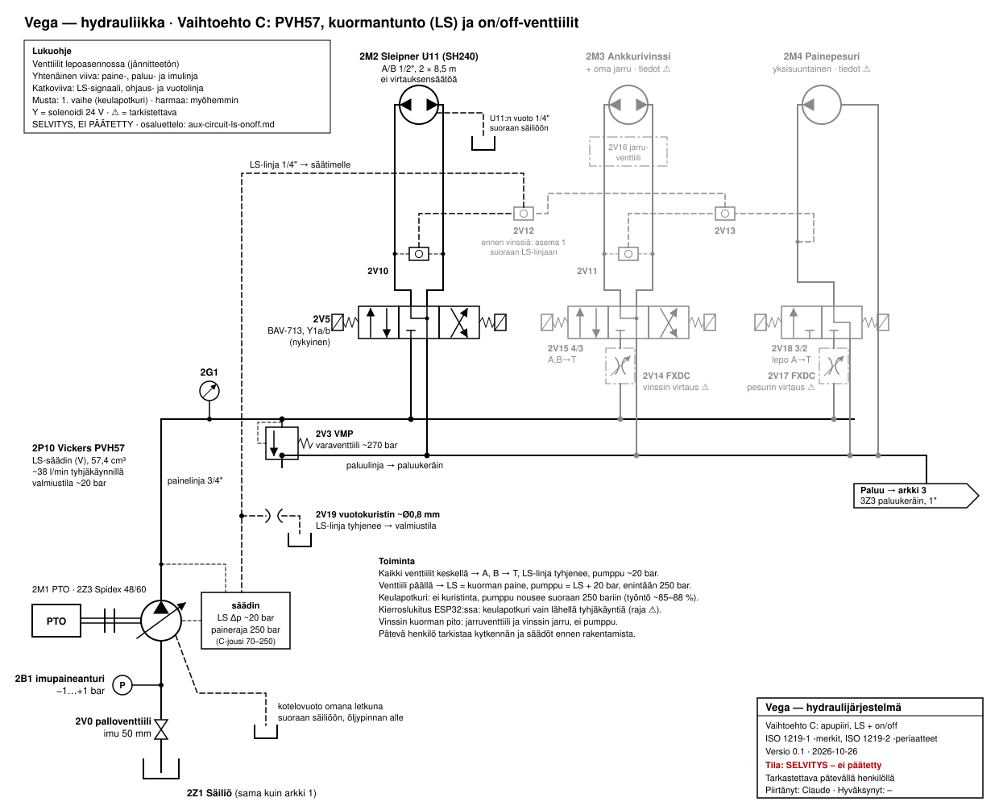

# Apupiiri alusta alkaen: säätötilavuuspumppu, LS ja on/off-venttiilit

> **Tila:** ajatuskoe 2026-10-26, päivitetty 2026-10-26 (FXDC:n kuvaaja; potkuri ei ime ilmaa; ISO 1219 -kaavio; muutosyhteenveto ja kierroslukitus), **varavaihtoehto**. **Pumppu on päätetty 2026-10-27: PVH57** (F1-61-vaihtoehto
> [arkistoitu](archive/p2-pump-options.md)); venttiilikokoonpanon ykkösvaihtoehto on
> [PVG 32](aux-circuit-ls-clean-sheet.md) (päätös 2026-10-27). Tämä toteutetaan, jos PVG 32 ei onnistu. Tässä kysytään, miten apupiiri
> rakennettaisiin alusta alkaen säätötilavuuspumpulla **ilman proportionaalista venttiilipöytää**
> [omistaja 2026-10-26, kysymys]. Vertailukohdat: PVH57 olemassa olevilla venttiileillä
> ([p2-variable-pump](p2-variable-pump.md)) ja PVH57 proportionaalisella LS-lohkoventtiilillä
> ([aux-circuit-ls-clean-sheet](aux-circuit-ls-clean-sheet.md)).
>
> Luvut ovat arvioita, ellei toisin merkitä. Pätevän henkilön pitää tarkistaa kytkentä,
> säätöarvot ja erityisesti ankkurivinssin kuorman pito ennen rakentamista.

## Selkokielinen yhteenveto

- Rakenne on **kuormantunteva (LS) järjestelmä, jossa on tavalliset on/off-magneettiventtiilit.**
  Pumpun LS-signaali otetaan vaihtoventtiileillä suoraan kuormien A/B-linjoista.
- **Pumppu tietää itse, milloin sitä tarvitaan.** Kun mikään venttiili ei ole päällä, keskiasento
  yhdistää A- ja B-linjat säiliöön, LS-linja tyhjenee ja pumppu jää noin 20 barin valmiustilaan.
  LS-purkuventtiiliä (2/2), 3/2-valintaventtiiliä ja ohjelman ohjausjärjestystä ei tarvita.
- **Keulapotkurilinjassa ei ole kuristinta eikä virtauksensäätöä,** joten pumppu nousee suoraan
  250 bariin ja työntövoima on arviolta 85–88 % ([päätös 2026-10-21](../../decisions.md): noin 90 %
  hyväksytty). Ylikierrossuojaa ei tarvita, koska potkuri on niin syvällä, ettei se saa ilmaa
  lapoihin [omistaja 2026-10-26].
- **Vinssi ja painepesuri saavat oman kompensoidun virtauksensäätönsä,** ja pumppu pitää paineen vain
  noin 20 bar kuorman yläpuolella. Öljyyn syntyy vähän lämpöä millä tahansa kierroksilla.
- **Kustannus on lähellä halvinta reittiä:** CETOP-pohjalaatta, BAV-713, VMP, letkut, säiliö ja
  jäähdytin käyvät tähän sellaisinaan. Portaatonta ohjausta ei saada.

## Mitä muuttuu nykyiseen suunnitelmaan verrattuna

Vertailukohta on nykyinen suunnitelma (F1-61, BPV-ohitusventtiili ja VPR3,
[p2-pump-options](archive/p2-pump-options.md)) ja veneessä jo olevat osat.

**Toiminta:**
- Pumppu tuottaa vain sen öljyn, jonka kuormat käyttävät. Ylimäärää ei kuristeta lämmöksi.
- Lepotilaan ei tarvita ohitus- tai vapaakiertoventtiiliä eikä ohjausjärjestystä: kun venttiilit
  ovat keskellä, pumppu jää itsestään noin 20 barin valmiustilaan.
- Keulapotkurin linjassa ei ole virtauksensäätöä; työntövoima arviolta 85–88 %.

**Käytetään uudelleen:** CETOP 3 -pohjalaatta ja BAV-713; VMP varaventtiiliksi noin 270 bariin;
keulapotkuri ja sen A/B-letkut; säiliö, painemittari, imun palloventtiili ja imupaineanturi;
jäähdytin ja paluulinjan osat. Ohjauspiiri pysyy ennallaan.

**Poistuu:** VPR3, OD15-vapaakiertoventtiili, F1-61:n BPV-F1-ohitusventtiili (ei hankittu) sekä
BPV:n ohjauksen vaatima paineanturi ja ohjauslogiikka.

**Uudet osat, 1. vaihe (keulapotkuri):**
- Vickers PVH57 (190 €).
- Kannake ja kytkimen pumppunapa. Ne tarvitaan kummassakin reitissä, mutta PVH57:lle SAE C
  -laipalle ja 1,25":n kiila-akselille.
- SAE-laippaliittimet, kotelovuotoletku säiliöön; keulapotkurin moottorin vuotolinja suoraan
  säiliöön.
- LS-linja: yksi vaihtoventtiili, vuotokuristin noin Ø0,8 mm ja 1/4":n letku.
- Lasikuitusuodatus, koska nykyinen paperisuodatin ei riitä: OMTF171F10NA1 kanteen tai
  linjasuodatin paluulinjaan ([p2-variable-pump](p2-variable-pump.md#paluusuodattimen-vaihto-omtf171f10na1)).
- 1":n paluulinja ja paluukeräin (suositeltu kummallekin reitille, [oil-cooling](oil-cooling.md#paluulinjan-letkukoko)).

**Uudet osat myöhemmin (vinssi ja pesuri):** kummallekin FXDC runkoineen, vinssille 4/3-venttiili
ja jarruventtiili, pesurille 3/2-venttiili sekä vaihtoventtiilit asemien välille.

**Avoinna ennen valintaa:** pumpun kunto koeajossa, mahtuuko isompi suodatin kanteen,
kierroslukituksen tarve ja raja (ks. [Kierroslukitus](#tarvitaanko-kierroslukitus)),
vaihtoventtiilien malli.

## Kaavio

```
PTO ─ HRC150 ─ PVH57 (LS-säädin, 250 bar) ──P──┬─ varaventtiili ~270 bar ──► T
        │   ▲                                  ├─ 1 keulapotkuri: ────────────── 4/3 on/off, A,B→T keskellä ─► keula
        │   │                                  ├─ 2 vinssi:       FXDC (vinssin virtaus) ─ 4/3 on/off, A,B→T ─ jarruventtiili ─► moottori
        │   │                                  └─ 3 pesuri:       FXDC (pesurin virtaus) ─ on/off ─► moottori
        │   └── LS ◄── vaihtoventtiilit (suurin A/B-paine kaikista lohkoista) + vuotokuristin Ø0,8 ─► T
        └── kotelovuoto, oma letku öljypinnan alle ──► säiliö
```

Ohjauspiiri (P1, orbitroli) pysyy erillään kuten nyt ([päätös 2017-04](../../decisions.md)).

### ISO 1219 -kaavio (luonnos)



Piirretty samoin periaattein kuin [arkit 1–3](../schematic.md): venttiilit lepoasennossa,
tunnus *piiri + tyyppi + numero*. Nykyisestä suunnitelmasta säilyvät osat pitävät tunnuksensa
(2V3, 2V5, 2M2, 2V0, 2B1); uudet osat on numeroitu 10:stä alkaen. **Musta = ensimmäinen vaihe**
(pumppu ja keulapotkuri), **harmaa = lisätään myöhemmin** (vinssi ja pesuri). Paluu jatkuu arkin 3
paluukeräimeen ([schematic](../schematic.md#arkki-3-paluu-jäähdytys-ja-säiliö)). **Tila: selvitys,
ei päätetty, ei rakentamiseen.** Pätevän henkilön pitää tarkistaa kaavio ennen rakentamista.

| Tunnus | Osa | Tiedot | Vaihe |
|---|---|---|---|
| 2M1, 2Z3 | Advance 300 PTO, HRC 150 -joustokytkin (päätös 2026-10-27) | kuten [arkki 2](../schematic.md#arkki-2-piiri-2-apupiiri-ja-keulapotkuri); Taper Lock 2012 -holkit 48 mm (PTO) ja 1 1/4" (pumppu) | 1 |
| 2P10 | Vickers PVH57, LS-säädin (V) | 57,4 cm³; painekompensaattori 250 bar, LS-paine-ero noin 20 bar; kotelovuoto omana letkuna säiliöön | 1 |
| 2V0, 2B1 | Imun palloventtiili, imupaineanturi | imu 50 mm, kuten arkki 2 | 1 |
| 2G1 | Painemittari | P-linja | 1 |
| 2B2 | Paineanturi 0–400 bar, 4–20 mA → ESP32 PDM | painevalvonta: paine alle noin 150 bar venttiilin ollessa päällä → Y1a/b pois ja hälytys ([Painevalvonta](#painevalvonta-arvio)); raja ja viive **⚠** käyttöönotossa | 1 |
| 2V3 | VMP (nykyinen) | varaventtiili noin 270 bar; rajaa paineen, jos säädin jumittuu | 1 |
| 2V5 | BAV-713 4/3 (nykyinen), Y1a/b | keskiasento P kiinni, A, B, T yhdistetty; CETOP 3 -pohjalaatalla | 1 |
| 2V10 | Vaihtoventtiili (shuttle valve, "OR-venttiili") keulapotkurin A/B-linjoista | linjamalli, kaksi tuloa ja lähtö, G 1/4" tai G 3/8", vähintään 350 bar; virtaus vain muutamia l/min; ks. [LS-linjan venttiilit](#ls-linjan-venttiilit); malli **⚠ valitsematta** | 1 |
| 2V19 | Vuotokuristin noin Ø0,8 mm | LS-linjasta säiliöön; LS-linja tyhjenee, kun venttiilit ovat keskellä | 1 |
| 2M2 | Sleipner U11 (SH240) | A/B 1/2", 2 × 8,5 m; ei virtauksensäätöä; vuotolinja suoraan säiliöön | 1 |
| 2V12, 2V13 | Vaihtoventtiilit asemien välillä | välittävät suurimman kuorman paineen pumpulle; ennen vinssiä aseman 1 signaali menee suoraan LS-linjaan | myöhemmin |
| 2V14, 2V15, 2V11, 2V16, 2M3 | Vinssi: FXDC, 4/3 A,B→T, vaihtoventtiili, jarruventtiili, moottori | vinssin tiedot **⚠ ei tiedossa** ([loads.yaml](../loads.yaml)) | myöhemmin |
| 2V17, 2V18, 2M4 | Pesuri: FXDC, 3/2 (lepo A→T), moottori | pesurin tiedot **⚠ ei tiedossa**; LS-signaali suoraan A-linjasta | myöhemmin |

### LS-linjan venttiilit

LS-linjaan ei tarvita ohjattavaa magneettiventtiiliä. Ensimmäisessä vaiheessa uusia osia on kaksi
[arvio]:

1. **Vaihtoventtiili 2V10** (shuttle valve). Passiivinen kuulaventtiili, jossa on kaksi tuloa ja
   yksi lähtö: suuremman paineen tulo sulkee toisen, ja lähtöön pääsee aina A- tai B-linjan
   suurempi paine. Tulot T-liittimillä keulapotkurin A- ja B-letkuista, lähtö 1/4":n LS-letkulla
   pumpun LS-porttiin.
   - **Vaatimukset:** linjamalli, BSPP-liitännät (esim. G 1/4"), paineluokka vähintään 350 bar
     (A/B-linjoissa on 250 bar, ja keulapotkurin pysähtyessä voi tulla paineiskuja). Virtaus on
     pieni (LS-linjan täyttö ja vuotokuristin), joten pienin koko riittää.
   - **Vaihtoehto:** CETOP 3 -välilaatta, jossa vaihtoventtiili ja LS-portti, BAV-713:n ja
     pohjalaatan väliin. Siistimpi, vähemmän letkuja; saatavuus ja hinta **⚠ tarkista**.
2. **Vuotokuristin 2V19,** noin Ø0,8 mm, LS-linjasta säiliöön. Kuristinnippa tai kuristinruuvi
   1/4":n liittimeen. Se tyhjentää LS-linjan, kun venttiili palaa keskelle; keskiasennon A,B→T-yhteys
   tyhjentää linjan myös venttiilin kautta.

Myöhemmin vinssi ja pesuri tuovat vaihtoventtiilit 2V11–2V13 (samaa tyyppiä). PVH57:n LS-portin
koko **⚠ ei tiedossa** (asennuspiirustus M-2206-S).

Kaaviota piirtäessä esiin tulleet asiat:

- Vinssi ja pesuri ovat kaaviossa omina linjaventtiileinään. Jos ne asennetaan CETOP-pohjalaatan
  vapaille paikoille, FXDC tarvitsee välilaatan tai linjarungon (avoin kysymys alla).
- Kaaviossa vinssin jarruventtiili on yksinkertaistettu lohkoksi; sen tyyppi ja asetus valitaan
  vinssin moottorin mukaan.

## Osat ja perustelut

| # | Osa | Tehtävä | Huom. |
|---|---|---|---|
| 1 | PVH57, LS-säädin, painekompensaattori 250 bar | Tuottaa vain sen, mitä kuormat ottavat; tyhjäkäynnillä noin 38 l/min [laskelma, ks. [p2-variable-pump](p2-variable-pump.md#sopivuus-vegaan-laskelma)] | Veto, kannake, 50 mm:n imu ja kotelovuoto kuten [p2-variable-pump](p2-variable-pump.md#tarvittavat-osat-pumpun-lisäksi-minimi) |
| 2 | 4/3 on/off -suuntaventtiilit, keskiasennossa A,B→T | Keskellä potkuri pyörii vapaasti, vinssin jarruventtiili sulkeutuu ja LS-linja tyhjenee | Keulapotkurille käy nykyinen BAV-713 |
| 3 | Vaihtoventtiilit A/B-linjoista ja lohkojen välillä LS-porttiin | Tuo suurimman kuorman paineen pumpun säätimelle | Pieniä linjamallisia vaihtoventtiileitä, malli **⚠ valitsematta** |
| 4 | Vuotokuristin noin Ø0,8 mm LS-linjasta säiliöön | Varmistaa, että LS-linja tyhjenee ja pumppu palaa valmiustilaan | |
| 5 | Kaksitiekompensoitu virtauksensäätö (Sun FXDC) vinssille ja pesurille | Pitää nopeuden vakiona myös yhtäaikaisessa käytössä; keulapotkurin linjaan sitä ei tarvita (ks. alla) | FXDC ja runko DAW/S, ks. [vaihtoehdot](p2-variable-pump.md#kaksitiekompensoidun-virtauksensäätöventtiilin-vaihtoehdot). Asennus välilaattana tai linjarunkona **⚠ tarkista** |
| 6 | Varaventtiili (nykyinen VMP) noin 270 bariin | Rajaa paineen, jos pumpun säädin jumittuu | Pätevä henkilö säätää |
| 7 | Vinssin jarruventtiili moottorilla ja vinssin oma jarru | Kuorman pito | Vinssin tiedot **⚠ ei tiedossa** ([loads.yaml](../loads.yaml)) |
| 8 | Jäähdytin termostaattiohituksella, paluusuodatin 10 µm lasikuitua | Mäntäpumppu vaatii 250 barissa puhtausluokan 16/14/12 (17/15/13 140–210 barissa) | Nykyinen OMTF112C10NA2 (arviolta selluloosa nominaalinen) ei riitä sellaisenaan [omistaja 2026-10-26]: ehdokas OMTF171F10NA1, ks. [p2-variable-pump](p2-variable-pump.md#paluusuodattimen-vaihto-omtf171f10na1). Jäähdytin: [oil-cooling](oil-cooling.md) |

**Miksi keulapotkurille ei tarvita virtauksensäätöä:** 250 barissa moottori ottaa itse noin
33 l/min (interpoloitu Sleipnerin taulukosta [datalehti Side-Power SH Series v1.0.0 2017]), joten
virtausta ei tarvitse rajata. Ylikierrossuojaa tarvittaisiin vain, jos potkuri imisi ilmaa ja sen
kuorma katoaisi. **Vegan potkuri on niin syvällä, ettei se koskaan saa ilmaa lapoihin**
[omistaja 2026-10-26]. FXDC jätetään siksi pois, ja sen noin 8 barin painehäviö säästyy
(datalehden kuvaajan mukaan noin 33 l/min kulkee FXDC:n läpi noin 8 barin paine-erolla;
työntövoimassa noin 3 prosenttiyksikköä [datalehti Sun FXDC, kuvaajasta luettu; arvio]).

**Jäljelle jäävä riski:** jos moottorin ja potkurin välinen veto (kytkin, akseli) katkeaa, moottori
menettää kuormansa ja ryntää. Ks. [Tarvitaanko kierroslukitus](#tarvitaanko-kierroslukitus).

### Tarvitaanko kierroslukitus

F1-61-reitillä kierroslukitus on välttämätön lämmön takia (1800 rpm:llä noin 38 kW,
[p2-pump-options](archive/p2-pump-options.md)). **Vaihtoehdossa C se ei ole välttämätön** [arvio]:

- **Kun veto on kunnossa, kierrokset eivät haittaa.** Pumppu pysyy 250 barissa ja antaa vain sen
  noin 33 l/min, jonka moottori ottaa. Lämpöä ei synny ylimäärästä, ja työntövoima on sama kuin
  tyhjäkäynnillä.
- **Ainoa syy on vedon katkeaminen** (moottorin ja potkurivaihteen välinen kytkin tai akseli).
  Silloin moottori menettää kuormansa, paine putoaa, ja pumppu syöttää moottorille kaiken, mitä se
  kierroksilla antaa [laskelma: 57,4 cm³ × rpm × 0,95]:

  | Koneen kierrokset | Pumpun tuotto | Suhteessa moottorin nimellisvirtaan (33,8 l/min) |
  |---|---|---|
  | 700 rpm | noin 38 l/min | noin 1,1-kertainen |
  | 1000 rpm | noin 55 l/min | noin 1,6-kertainen |
  | 1800 rpm | noin 98 l/min | noin 2,9-kertainen |

  Moottorin kierrosnopeus kasvaa samassa suhteessa. U11:n suurinta sallittua kierrosnopeutta ei
  tiedetä (**⚠ ei tiedossa**, kysy Sleipneriltä), mutta lähes kolminkertainen ylikierros
  todennäköisesti rikkoo moottorin laakerit tai tiivisteet [arvio]. Ihmisille vaaraa ei synny:
  moottori on suljettu, ja paine on tällöin matala.
- **Ilman kierroslukitusta** riski toteutuu vain, jos veto katkeaa juuri silloin, kun keulapotkuria
  käytetään korkeilla kierroksilla. Keulapotkuria käytetään satamassa tyhjäkäynnillä, joten
  yhdistelmä on harvinainen [arvio]. Seuraus on moottorivaurio, ei vaaratilanne.

**Vaihtoehdot:**

1. **Kierroslukitus ESP32:ssa** (suositus [arvio]): keulapotkurin venttiiliä ei ohjata, jos
   kierrokset ovat yli rajan (esim. noin 900–1000 rpm, **⚠ raja valitsematta**). Halpa, jos
   ESP32 PDM saa kierrostiedon joka tapauksessa (Signal K); muuten tarvitaan kierroslukuanturi.
2. **Käyttösääntö ilman elektroniikkaa:** keulapotkuria käytetään vain tyhjäkäynnillä. Ei
   maksa mitään, mutta ei suojaa unohdukselta.
3. **FXDC keulapotkurin linjaan** ylikierrossuojaksi: rajaa virtauksen noin 34 l/min:iin kaikilla
   kierroksilla, mutta vie noin 8 bar ja työntövoimasta noin 3 prosenttiyksikköä (ks. yllä).
4. **Painevalvonta P2:n lähdön paineanturilla** (2B2, ks.
   [pressure-monitoring](pressure-monitoring.md)): tunnistaa vian, ei tarvitse kierrostietoa.

#### Painevalvonta [arvio]

**Miten vika näkyy:** normaalisti paine nousee keulapotkurin käynnistyessä lähes heti 250 bariin
(täysi työntö vaatisi noin 264 bar). Jos veto katkeaa, kuorma katoaa ja paine putoaa letkujen ja
venttiilin häviöihin, muutamaan kymmeneen bariin. Ero on suuri, joten raja on helppo asettaa.

**Logiikka ESP32:ssa:**

1. Keulapotkurin venttiili ohjataan päälle.
2. Odotetaan noin 0,5–1 s, että paine nousee (**⚠ viive tarkistetaan käyttöönotossa**).
3. Jos paine on venttiilin ollessa päällä alle rajan (esim. 150 bar, **⚠ raja tarkistetaan
   mittaamalla**), venttiilin virta katkaistaan, annetaan hälytys ja uudelleenkäynnistys estetään,
   kunnes vika kuitataan.
4. Anturin vika tai katkennut johto (4–20 mA: alle 4 mA) tulkitaan viaksi.

**Rajoitukset:**

- **Ylikierrosta ei estetä kokonaan.** Kuormaton moottori kiihtyy sekunnin murto-osassa, joten
  tunnistusviive ja venttiilin sulkeutuminen (noin 50 ms) ovat ylikierrosaikaa. Vaurio jää
  todennäköisesti paljon pienemmäksi kuin jatkuvassa ylikierroksessa, mutta suoja ei ole täysi.
  Kierroslukitus estää suuren virtauksen ennalta.
- **Väärät laukeamiset ovat epätodennäköisiä,** koska potkuri ei saa ilmaa lapoihin
  [omistaja 2026-10-26] ja kylmä öljy vain nostaa painetta.

**Miksi paineanturi eikä virtausanturi:** hydrauliikan virtausanturi maksaa arviolta satoja euroja
ja lisää painehäviötä; paineanturi noin 40–150 € ([pressure-monitoring](pressure-monitoring.md)).
F1-61-reitillä 2B2 tarvittaisiin BPV:n ohjaukseen; vaihtoehdossa C sama anturi hoitaa tämän
valvonnan ja paljastaa muitakin vikoja (säädin ei nosta painetta, venttiili ei avaudu, paine jää
korkeaksi venttiilin sulkeuduttua).

**Suositus [arvio]:** halvin hyvä yhdistelmä on käyttösääntö (keulapotkuri tyhjäkäynnillä) ja
painevalvonta. Kierroslukitus lisätään, jos kierrostieto saadaan helposti. Kumpikaan ei ole
välttämätön, koska vika ei aiheuta vaaraa ihmisille. Omistajat päättävät. Ohjauslogiikka liittyy
turvallisuuteen, joten pätevän henkilön pitää tarkistaa se ennen käyttöä.

**Miksi vinssille ja pesurille kompensoitu virtauksensäätö eikä pelkkä kuristin:** kun keulapotkuri
pitää pumpun 250 barissa, matalan paineen kuorman kuristimen yli olisi suuri paine-ero. Se veisi
virtauksen potkurilta. FXDC pitää asetetun virtauksen paine-erosta riippumatta. Jos vinssiä ja
pesuria ei koskaan käytetä keulapotkurin kanssa yhtä aikaa, halvempi säädettävä kuristin riittää.

## Miten 250 bar ja 20 barin marginaali sopivat yhteen

PVH57:n säätimessä on kaksi karaa, jotka säätävät samaa iskunpituutta [M-2210-S s. 6, ks.
[p2-variable-pump](p2-variable-pump.md#miten-ls-linjaa-käytetään)]:

1. **LS-kara** yrittää pitää pumpun lähtöpaineen noin 20 bar LS-portin painetta korkeampana.
2. **Paineenrajoitin** pienentää iskua niin, ettei lähtöpaine ylitä 250 baria.

Pumppu tottelee sitä, joka vaatii pienempää tuottoa. **Pumpun paine on siis kuorman paine + 20 bar
tai 250 bar, kumpi on pienempi.**

- **LS-paine ei ole pumpun tuottama erillinen paine.** Se on mittaussignaali: kuorman oma paine,
  joka tuodaan vaihtoventtiileillä A- tai B-linjasta säätimelle. Mikään paine ei nouse 250 barin
  yli.
- **Keulapotkurilla:** täyteen työntöön tarvittaisiin 264 bar, joten LS-kara pyytäisi noin
  284 bar. Paineenrajoitin pysäyttää pumpun 250 bariin, ja pumppu säätää iskun juuri sille
  virtaukselle, jolla 250 bar säilyy (noin 33 l/min). Paine-ero pumpun ja moottorin välillä on
  silloin vain BAV-713:n ja letkujen todellinen häviö (**⚠ ei mitattu**) [arvio].
- **Siksi keulapotkurilinjassa ei saa olla kuristinta.** Kuristinvaihtoehdossa
  ([p2-variable-pump](p2-variable-pump.md#vaihtoehto-aito-kuormantunto-säädettävällä-kuristimella))
  virtaus rajattiin kuristimella, joka tarvitsi 20 barin paine-eron, ja moottori sai vain noin
  230 bar (työntövoima noin 80 %).
- **Yhtäaikaisessa käytössä:** kun keulapotkuri pitää pumpun 250 barissa, vinssin FXDC:n yli on
  250 bar miinus vinssin paine, ja FXDC pitää vinssin nopeuden asetuksessa. Ongelma tulee vain, jos
  vinssikin tarvitsee yli noin 230 baria. Silloin FXDC:n yli ei jää sen tarvitsemaa noin 15–20 baria,
  ja vinssi hidastuu.
- **Vinssi yksin:** FXDC:n ja suuntaventtiilin yli on noin 20 bar. Datalehden kuvaajan mukaan
  30–40 l/min:n asetus saavuttaa asetusvirtauksen noin 15–20 barissa ja noin 95 % jo noin
  12–14 barissa, pienemmät asetukset noin 10 barissa. Vinssi saa siis lähes asetusvirtauksen; jos
  se jää vajaaksi, pumpun LS-paine-eroa voi nostaa muutamalla barilla (**⚠ säätöalue tarkista
  Danfossilta**) [datalehti Sun FXDC, kuvaajasta luettu].

## Vertailu

| | PVH57 + vanhat venttiilit ([p2-variable-pump](p2-variable-pump.md)) | PVG-venttiilipöytä ([aux-circuit-ls-clean-sheet](aux-circuit-ls-clean-sheet.md)) | **LS + on/off (tämä)** |
|---|---|---|---|
| Ohjauslogiikka | 2/2 (ja 3/2) oikeassa järjestyksessä | PVE-ohjaimet | **ei mitään, pelkät kytkimet** |
| Vika "2/2 jää kiinni", noin 10 kW lämpöä | mahdollinen | ei | **ei** |
| Lämpö vinssillä | 3–11 kW ilman 3/2:ta | pieni | **pieni** |
| Keulapotkurin työntövoima | noin 82–85 % (FXDC yhteisessä P-linjassa) | noin 85–88 % (enemmän, jos paine nostetaan) | noin 85–88 % |
| Portaaton ohjaus | ei | kyllä | ei |
| Kustannus | pienin | suurin | lähellä pienintä |

**Poistuu nykysuunnitelmasta:** VPR3, OD15, BPV sekä PVH57-selvityksen 2/2- ja 3/2-ratkaisut.
**Säilyy:** CETOP-pohjalaatta, BAV-713, VMP, säiliö, 50 mm:n imu, kytkin ja kannake, letkut ja
jäähdytin. **Uutta:** kaksi FXDC:tä runkoineen (vinssi ja pesuri) (FXDC noin 83–89 $ USA:ssa 2026-10-25,
valurautaisen DAW/S-rungon hinta **⚠ ei tiedossa**), muutama vaihtoventtiili, vuotokuristin ja
vinssin jarruventtiili.

## Vikatilat

| Vika | Mitä tapahtuu |
|---|---|
| Sähkökatko | Venttiilit palaavat keskelle, LS-linja tyhjenee ja pumppu menee valmiustilaan. Keulapotkuri pysähtyy ja pyörii vapaasti; vinssin jarru ja jarruventtiili pitävät. |
| Suuntaventtiili jumittuu auki | Kuorma jää käyntiin. Hätäpysäytys katkaisee kelojen virran; jos kara ei palaa, pumpun kierrokset tai imulinjan palloventtiili ovat ainoa keino **⚠ pätevä henkilö arvioi**. |
| LS-linjan vuotokuristin tukkeutuu | Pumppu voi jäädä venttiilien palattua keskelle hetkeksi korkeaan paineeseen; keskiasennon A,B→T-yhteys tyhjentää linjan silti. |
| Pumpun säädin jumittuu täydelle tuotolle | Varaventtiili rajaa paineen; tilanne vastaa kiinteää pumppua (lämpöä), ja lämpötila-anturi hälyttää. |
| Keulapotkurin veto (kytkin, akseli) katkeaa | Moottori menettää kuormansa ja ryntää, koska linjassa ei ole virtauksensäätöä. Kierroslukitus rajaa pumpun tuoton (tyhjäkäynnillä noin 38 l/min); painevalvonta (2B2) tunnistaa paineen putoamisen ja katkaisee venttiilin virran; hätäpysäytys katkaisee venttiilin virran. |
| Kotelovuotolinja tukkeutuu | Akselitiiviste voi vaurioitua; siksi vuotolinja on oma letkunsa. |
| Vinssi kuormassa ja hydrauliikka menetetään | Jarruventtiili ja vinssin jarru pitävät kuorman, ei pumppu eikä venttiilin kara. **Pätevä henkilö tarkistaa ennen rakentamista.** |

## Avoimet kysymykset

- [x] ~~Sun FXDC:n pienin paine-ero~~ noin 15–20 bar 30–40 l/min:n asetuksella, noin 10 bar ≤ 23 l/min:llä; 20 barin marginaali riittää lähes [datalehti Sun FXDC 2026-10-26, kuvaajasta luettu]
- [x] ~~Keulapotkurin ylikierrossuoja FXDC:llä vai kierroslukituksella~~ FXDC:tä ei tarvita: potkuri ei saa ilmaa lapoihin [omistaja 2026-10-26]
- [ ] Omistajat: kierroslukitus vai käyttösääntö, ja lukituksen raja (suoja vedon katkeamisen varalle, ks. [Tarvitaanko kierroslukitus](#tarvitaanko-kierroslukitus))
- [ ] Sleipner: U11-moottorin suurin sallittu kierrosnopeus
- [ ] Saako ESP32 PDM kierrostiedon (Signal K) vai tarvitaanko anturi
- [ ] Painevalvonnan raja ja viive: mitataan keulapotkurin paine käyttöönotossa (normaali käynnistys, kylmä ja lämmin öljy)
- [ ] Lohkokohtaisen FXDC:n asennus CETOP-pohjalaatalle: välilaatta (malli) vai linjarunko kunkin aseman letkuun
- [ ] Danfoss: PVH57:n kierrosraja (2400 rpm) yhtäaikaisessa käytössä, kun 38 l/min ei riitä kahdelle kuormalle tyhjäkäynnillä
- [ ] Vaihtoventtiilien malli ja liitäntäkoko
- [ ] Ankkurivinssin moottori, jarru ja jarruventtiili; painepesurin hydraulimoottorin virtaus ja paine ([loads.yaml](../loads.yaml))
