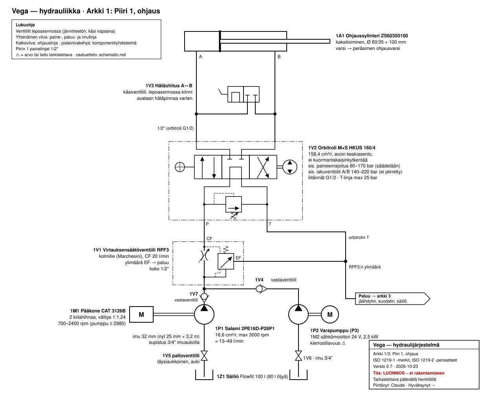
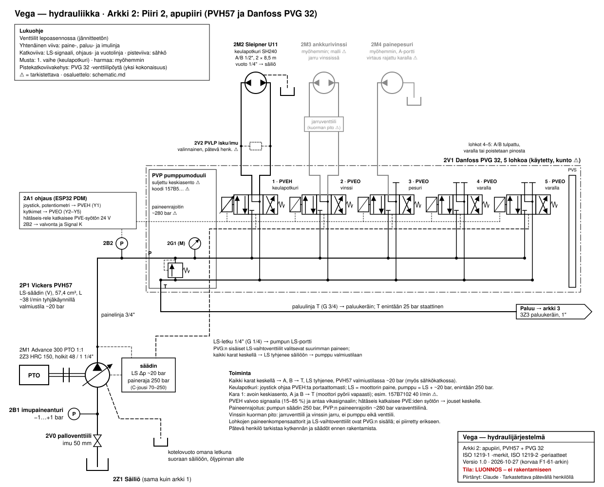
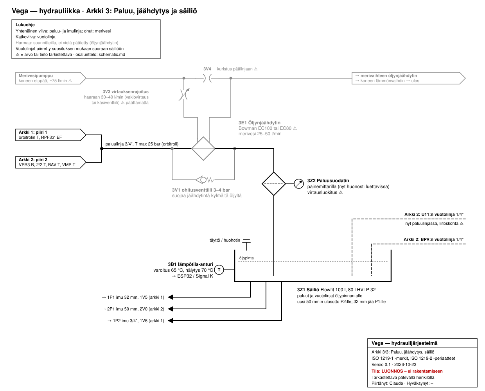
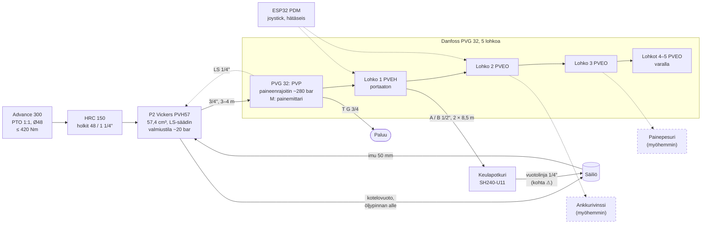
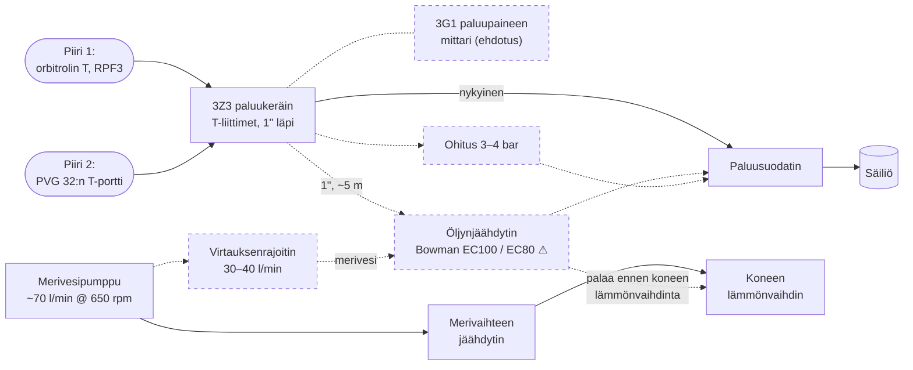

# Hydrauliikan kaavio (suunniteltu kokoonpano)

> **Tila:** päivitetty 2026-10-27: **arkki 2 piirretty uudelleen** (P2 = Vickers PVH57, HRC 150, venttiileiksi Danfoss PVG 32, ykkösvaihtoehto); F1-61-kokoonpanon arkki 2 ja sen taulukot [arkistoitu](design/archive/schematic-sheet-2-f1-61.md). Aiemmin 2026-10-23 ja 2026-10-26 (paluukeräin, 1":n paluulinja). Lohkokaavio suunnitellusta järjestelmästä, ei ISO 1219 -piirrosmerkein.
> Yhtenäinen viiva = olemassa tai päätetty, katkoviiva = suunnitteilla tai vaihtoehto.
> Lähteet ja tarkemmat arvot: [current-system.md](current-system.md),
> [design/p2-variable-pump.md](design/p2-variable-pump.md), [design/aux-circuit-ls-clean-sheet.md](design/aux-circuit-ls-clean-sheet.md), [arkisto: p2-pump-options](design/archive/p2-pump-options.md), [design/oil-cooling.md](design/oil-cooling.md).
> Vanha kaavio (2018): [img/hydraulics-v3-2018.png](img/hydraulics-v3-2018.png).
>
> **ISO 1219 -kaaviot** (2026-10-23, luonnos): arkki 1 ohjauspiiri, arkki 2 apupiiri ja keulapotkuri,
> arkki 3 paluu, jäähdytys ja säiliö. Alla olevat Mermaid-lohkokaaviot säilyvät yleiskuvana.
> Varavaihtoehdon C (PVH57, LS ja on/off-venttiilit) kaavio:
> [design/aux-circuit-ls-onoff.md](design/aux-circuit-ls-onoff.md#iso-1219--kaavio-luonnos).

## ISO 1219 -kaaviot (luonnos)

Piirretty ISO 1219-1:n piirrosmerkein ja ISO 1219-2:n periaattein: venttiilit lepoasennossa,
komponenttitunnus muotoa *piiri + tyyppi + numero* (P pumppu, M moottori, V venttiili, A toimilaite,
Z muu), osaluettelo alla. **Tila: luonnos, ei rakentamiseen.** Ohjaus on turvallisuuskriittinen:
pätevän henkilön pitää tarkistaa kaavio ennen rakentamista.

### Arkki 1: Piiri 1, ohjaus

| Tunnus | Osa | Tiedot | Lähde |
|---|---|---|---|
| 1M1 | Pääkone CAT 3126B, 2 kiilahihnaa | välitys 1:1,24; kone 700–2400 rpm | [blogi 2017-07-04], [omistaja 2026-10-22] |
| 1P1 | Ohjauspumppu Salami 2PE16D-P28P1 | 16,6 cm³/r, max 3000 rpm, imupaine ≥ 0,7 bar abs, imuaukko 3/4" | [datalehti Salami 2PE], [omistaja 2026-10-23] |
| 1V5 | Imulinjan palloventtiili | täysiaukkoinen, auki ajossa; imu 32 mm (päätös 2026-10-23; nyt 25 mm × 3,2 m) | [p1-steering-pump.md](design/p1-steering-pump.md) |
| 1V7 | P1:n vastaventtiili | ennen T-haaraa, jossa P1 ja P3 yhdistyvät | [omistaja 2026-10-23] |
| 1V1 | Kolmitievirtauksensäätöventtiili Marchesini RPF3 | vakiovirtaus CF 20 l/min orbitrolille pumpun kierroksista riippumatta, ylimäärä EF paluuseen; koko 1/2" [omistaja 2026-10-23] | [datalehti RPF3] |
| 1G1 | Painemittari, analoginen | P-linjan alussa heti RPF3:n CF-lähdön jälkeen | [omistaja 2026-10-23] |
| 1V2 | Orbitroli M+S HKUS 160/4 | 158,4 cm³/r, avoin keskiasento, ei kuormantakaisinkytkentää; sis. paineenrajoitus 80–170 bar (säädetään käyttöönotossa), iskuventtiilit 140–220 bar; T max 25 bar | [datalehti HKUS] |
| 1V3 | Hätäohitus A↔B | käsiventtiili sylinterin vieressä, lepoasennossa kiinni | [blogi 2017-07-04] |
| 1A1 | Ohjaussylinteri ZS60350100, kaksitoiminen | männän Ø 60 mm, varren Ø 35 mm, isku 100 mm | [omistaja 2026-10-23], [blogi 2017-07-04] |
| 1P2, 1M2 | Varapumppu P3, sähkömoottori 24 V 2,5 kW | kytketty T-haaraan oman vastaventtiilin kautta [omistaja 2026-10-23]; kierrostilavuus **⚠ ei tiedossa** | [blogi 2017-04-01] |
| 1V4 | P3:n vastaventtiili | ennen T-haaraa → RPF3 | [omistaja 2026-10-23] |
| – | Piirin 1 painelinjat | **1/2"** (P1/P3 → RPF3 → orbitroli → sylinteri) | [omistaja 2026-10-23] |
| 1V6 | P3:n imun palloventtiili | imu 3/4" | [blogi 2017-04-10] |
| 1Z1 | Säiliö Flowfit 100 l | 80 l öljyä | [blogi 2017-07-04] |

**Kaaviota piirtäessä esiin tulleet kysymykset:**

- ~~P1:n painelinjan vastaventtiili~~: on olemassa (1V7) ennen T-haaraa [omistaja 2026-10-23].
- Orbitrolin iskuventtiilejä ja imuventtiilejä ei ole piirretty erikseen (orbitrolin sisällä).
- Painelinjat 1/2" [omistaja 2026-10-23]; paluulinjojen koot puuttuvat.

### Arkki 2: Piiri 2, apupiiri (PVH57 ja PVG 32)

Piirretty 2026-10-27 ykkösvaihtoehdon mukaan (päätös 2026-10-27). PVG 32:n sisäiset
paineenkompensaattorit ja LS-vaihtoventtiilit on jätetty piirtämättä, ja PVE on piirretty
yksinkertaistettuna toimilaitteena karan toisessa päässä.
Edellinen versio (F1-61 + BPV): [arkisto](design/archive/schematic-sheet-2-f1-61.md).

| Tunnus | Osa | Tiedot | Lähde |
|---|---|---|---|
| 2M1 | Advance 300 PTO | 1:1, Ø48 mm kiila-akseli, ≤ 420 Nm; pyörii vastakkaiseen suuntaan kuin kone | [current-system §0](current-system.md), [omistaja 2026-10-23] |
| 2Z3 | HRC 150 -joustokytkin | Taper Lock 2012 -holkit 48 mm (PTO) ja 1 1/4" (pumppu); momentti noin 600 Nm **⚠ vahvista** | [päätös 2026-10-27](../decisions.md), [p2-variable-pump](design/p2-variable-pump.md#tarvittavat-osat-pumpun-lisäksi-minimi) |
| 2P1 | Vickers PVH57C-LAF-1S-10-C12V-31 | 57,4 cm³/r, LS-säädin, paineraja 250 bar, valmiustila noin 20 bar, pyörimissuunta L; SAE C -laippa omalla kannakkeella; kotelovuoto omana letkuna säiliöön | [p2-variable-pump](design/p2-variable-pump.md#tekniset-tiedot), [päätös 2026-10-27](../decisions.md) |
| 2V0 | Imulinjan palloventtiili | täysiaukkoinen; imu 50 mm | [päätös 2026-10-23](../decisions.md) |
| 2B1 | Imupaineanturi | −1…+1 bar, varoitus alle 0 bar | [päätös 2026-10-23](../decisions.md) |
| 2B2 | P2:n lähtöpaineanturi (ehdotus) | 0–400 bar; valmiustilan ja vedon valvonta → ESP32 / Signal K | [pressure-monitoring](design/pressure-monitoring.md) |
| 2V1 | Danfoss PVG 32, 5 lohkoa (käytetty) | P 350 bar (PVSI) / 300 bar (PVS), T enintään 25 bar staattinen; kokoonpanokoodi 157N553(8/B) **⚠ tarkista**; kunto tuntematon, puhdistus ja koestus | [aux-circuit-ls-clean-sheet](design/aux-circuit-ls-clean-sheet.md#ehdokas-danfoss-pvg-32-5-lohkoa-torifi) |
| 2V1.0 | PVP-pumppumoduuli | suljettu keskiasento **⚠ tarkista koodista** (157B5…); sisäinen paineenrajoitin noin 280 bar (varaventtiili); P-portti G 1/2–G 1, T G 3/4, LS G 1/4, M G 1/4 | [datalehti PVG 32 s. 5, 20–22] |
| 2G1 | Painemittari, analoginen | PVP:n M-portissa (G 1/4) | [aux-circuit-ls-clean-sheet](design/aux-circuit-ls-clean-sheet.md#mitä-keulapotkuri-tarvitsee-pvh57n-ja-tämän-venttiilin-lisäksi) |
| 2V1.1, Y1 | Lohko 1: keulapotkuri, PVEH 157B4024 | kara: avoin keskiasento, A ja B → T, 40 l/min (esim. 157B7102) **⚠ tarkista nykyinen kara**; ohjaus 0,25–0,75 × U | [datalehti PVG 32 s. 15–18, 56] |
| 2V2 | PVLP-isku- ja imuventtiilit lohkon 1 A/B-portteihin (valinnainen) | esim. 157B2280 (280 bar); tarve ja asetus pätevä henkilö **⚠** | [datalehti PVG 32 s. 27] |
| 2V1.2, Y2 | Lohko 2: ankkurivinssi, PVEO 157B4224 | myöhemmin; jarruventtiili vinssillä, kara **⚠** | [aux-circuit-ls-clean-sheet](design/aux-circuit-ls-clean-sheet.md) |
| 2V1.3, Y3 | Lohko 3: painepesuri, PVEO | myöhemmin; A-portti, virtaus rajattu karalla **⚠** | sama |
| 2V1.4–2V1.5, Y4–Y5 | Lohkot 4–5, PVEO | varalla, A/B tulpattu; voidaan poistaa pinosta (PVAS 4 lohkolle 157B8004) | [datalehti PVG 32 s. 28–29] |
| 2A1 | Ohjaus (ESP32 PDM) | joystick (potentiometri) → PVEH; kytkimet → PVEO; hätäseis-rele katkaisee PVE-syötön 24 V; PVEH:n vikasignaali Signal K:hon | [aux-circuit-ls-clean-sheet](design/aux-circuit-ls-clean-sheet.md) |
| 2M2 | Sleipner U11 / SH240 | 100 %: 33,8 l/min, 264 bar; A/B 1/2" SAE 100R2AT 2 × 8,5 m; vuotolinja 1/4" säiliöön | [ohje Sleipner 2746 35 2025] |
| 2M3, 2M4 | Ankkurivinssi, painepesuri | myöhemmin; mallit **⚠ ei tiedossa** | – |

### Arkki 3: Paluu, jäähdytys ja säiliö

| Tunnus | Osa | Tiedot | Lähde |
|---|---|---|---|
| 3E1 | Öljynjäähdytin Bowman EC100 tai EC80 **⚠** | suunnitteilla, ei päätetty; merivesi 25–50 l/min | [oil-cooling](design/oil-cooling.md) |
| 3V1 | Jäähdyttimen ohitusventtiili | 3–4 bar, rinnakkain jäähdyttimen kanssa | [oil-cooling](design/oil-cooling.md#paluulinja-asennus) |
| 3V3 | Merivesihaaran virtauksenrajoitus | 30–40 l/min; vakiovirtausventtiili tai käsiventtiili **⚠ päättämättä** | [oil-cooling](design/oil-cooling.md#merivesi) |
| 3V4 | Kuristus merivesipäälinjaan | ohjaa osan virtauksesta haaraan | [oil-cooling](design/oil-cooling.md#merivesi) |
| 3Z3 | Paluukeräin | paluut yhdistetään tavallisilla T-liittimillä venttiililohkon lähellä: 1" läpivirtaus, pienemmät paluut haaraan; BSPP + tiivistealuslevy; vuotolinjat eivät tule keräimeen | [oil-cooling](design/oil-cooling.md#paluiden-yhdistäminen) |
| – | Paluulinja | **1"**, noin 5 m (keräin → jäähdytin → suodatin); supistus 3/4":iin jäähdyttimen liitännöissä | [omistaja 2026-10-26], [oil-cooling](design/oil-cooling.md#paluulinjan-letkukoko) |
| 3G1 | Paluupaineen mittari (ehdotus) | keräimessä; näyttää kylmäkäynnistyksen paluupaineen ja jäähdyttimen tai suodattimen tukkeutumisen | [oil-cooling](design/oil-cooling.md#paluiden-yhdistäminen) |
| 3Z2 | Paluusuodatin OMT OMTF112C10NA2 | 10 µm (selluloosa, nominaalinen **⚠ tarkista**), 100 l/min, ohitus 1,7 bar; painemittarilla | [blogi 2017-04-10], [omistaja 2026-10-26], [jälleenmyyjä Phoenix Hydraulics](https://www.phoenixhydraulics.co.uk/omtf112c10na2.html) |
| 3Z1 | Säiliö Flowfit 100 l | 80 l HVLP 32; uusi 50 mm:n ulosotto P2:lle, 32 mm jää P1:lle | [päätös 2026-10-23](../decisions.md) |
| 3B1 | Öljyn lämpötila-anturi | varoitus 65 °C, hälytys 70 °C → ESP32 / Signal K | [päätös 2026-10-23](../decisions.md) |

**Arkkeja 2 ja 3 piirtäessä esiin tulleet asiat (päivitetty 2026-10-27):**

- Vuotolinjat (PVH57:n kotelovuoto ja U11) on piirretty suoraan säiliöön öljypinnan alle. U11:n
  vuotolinja on nyt paluulinjassa, ja liitoskohta pitää tarkistaa.
- PVG 32:n T-portin suurin paine on 25 bar staattinen: paluulinjan jäähdytin, ohitus ja suodatin
  pitävät sen alle, kunhan kylmäkäynnistyksen paluupaine tarkistetaan (3G1).
- Arkki 3:n merkinnät päivitettiin 2026-10-27 (PVG:n T-portti, PVH57:n kotelovuoto); alkuperäinen
  [arkistossa](img/archive/schematic-3-return-cooling-f1-61.svg).

## 1. Voimansiirto ja ohjauspiiri

## 2. Apupiiri: PTO-pumppu ja PVG 32

## 3. Paluu ja öljynjäähdytys

## Toimintatilat (apupiiri, PVH57 + PVG 32)

| Tila | PVE:t | PVH57 | Mitä tapahtuu |
|---|---|---|---|
| Ajo, ei käyttöä | jännitteettömiä tai keskellä | valmiustila ~20 bar, lähes nollatuotto | LS-linja tyhjenee säiliöön, kun kaikki karat ovat keskellä; vähän lämpöä (häviöteho **⚠ ei tiedossa**) |
| Keulapotkuri käytössä | PVEH ohjaa lohkoa 1 joystickin mukaan | paine = kuorman paine + ~20 bar, enintään 250 bar | potkuri saa noin 85–88 % työntövoimasta täydellä ohjauksella; virtaus rajautuu karan avautumaan |
| Vinssi tai pesuri (myöhemmin) | PVEO päälle/pois | kuten yllä | kuorman pito jarruventtiilillä ja vinssin jarrulla |
| Hätäseis tai sähkökatko | syöttö katkeaa, jouset keskelle | valmiustila | potkuri pysähtyy ja pyörii vapaasti avoimen keskiasennon kautta; käsivivut toimivat, jos kannoissa on vivut **⚠** |
| PVEH-vika (signaali 15–85 %:n ulkopuolella, johto poikki) | PVEH pysäyttää karan keskelle | valmiustila | vikasignaali → Signal K -hälytys |

## Avoimia kohtia kaaviossa

- ~~VMP:n fyysinen paikka~~: VMP jää pois, PVP:n paineenrajoitin toimii varaventtiilinä (2026-10-27)
- PVG 32:n pumppumoduulin tyyppi (suljettu keskiasento) ja lohkon 1 kara tarkistetaan venttiilistä **⚠**
- Venttiilipöydän (noin 22–23 kg) kiinnityspaikka konehuoneessa ja letkujen reititys **⚠**
- ~~2/2-venttiilin paikka~~: omassa erillisessä rungossaan [omistaja 2026-10-23]
- ~~Varapumpun P3 kytkentä~~: P1 ja P3 yhdistyvät T-haarassa kumpikin oman vastaventtiilin kautta RPF3:lle [omistaja 2026-10-23]
- Öljynjäähdytin ja merivesihaara ovat suunnitteilla. Iskuventtiileistä päätettiin 2026-10-23 F1-61-kokoonpanolle (ei lisätä); PVG 32:lla PVLP-isku- ja imuventtiilit (2V2) arvioi pätevä henkilö **⚠**
