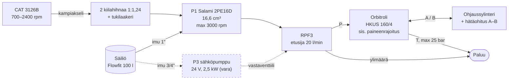
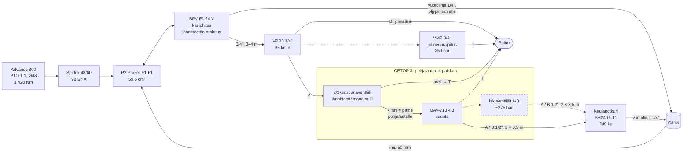
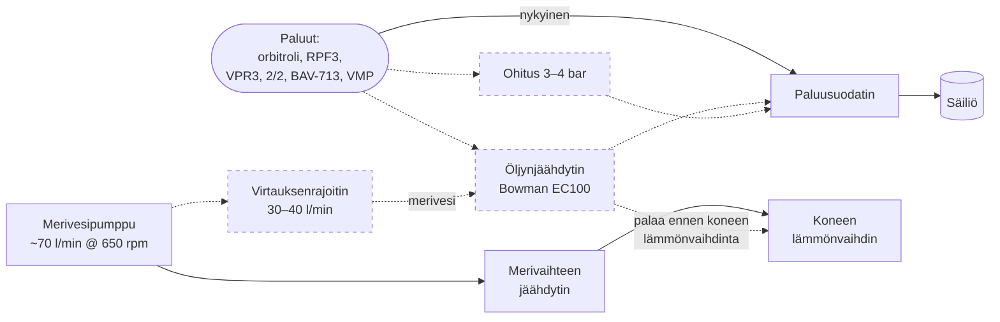

# Hydrauliikan kaavio (suunniteltu kokoonpano)

> **Tila:** päivitetty 2026-10-23 (P2 = F1-61 + BPV, Spidex-kytkin, 50 mm imu). Lohkokaavio suunnitellusta järjestelmästä, ei ISO 1219 -piirrosmerkein.
> Yhtenäinen viiva = olemassa tai päätetty, katkoviiva = suunnitteilla tai vaihtoehto.
> Lähteet ja tarkemmat arvot: [current-system.md](current-system.md),
> [design/p2-pump-options.md](design/p2-pump-options.md), [design/oil-cooling.md](design/oil-cooling.md).
> Vanha kaavio (2018): [img/hydraulics-v3-2018.png](img/hydraulics-v3-2018.png).

## 1. Voimansiirto ja ohjauspiiri

## 2. Apupiiri: PTO-pumppu ja keulapotkuri

Pohjalaatan paikat 2–4 ovat vapaana (esim. ankkurivinssi).

## 3. Paluu ja öljynjäähdytys

## Toimintatilat (apupiiri)

| Tila | BPV-F1 | 2/2-patruunaventtiili | BAV-713 | Mitä tapahtuu |
|---|---|---|---|---|
| Ajo | jännitteetön (ohitus) | jännitteetön, auki | keskellä | P2 pyörii mutta kiertää tyhjänä pumpun päädyssä; pieni jäähdytysvirtaus vuotolinjan kautta säiliöön (lämpö **⚠ ei tiedossa**) |
| Keulapotkuri valmiina (tyhjäkäynti) | jännitteellinen (vaihdettu 2/2:n ollessa auki, < 20 bar) | jännitteetön, auki | keskellä | P2:n öljy kiertää matalalla paineella säiliöön (~0,7 kW) |
| Keulapotkuri käytössä | jännitteellinen | jännitteellinen, kiinni | a tai b | Paine nousee pohjalaatalla; VPR3 rajaa virtauksen 35 l/min:iin; potkuri saa ~88 % työntövoimasta (~210 kg) |
| Kierroslukitus (> ~1000 rpm) | pakotetaan jännitteettömäksi (2/2 ensin auki) | pakotetaan jännitteettömäksi | estetty | Pumppu ohitukseen; hälytys, jos syöttö päällä yli ~1200 rpm |
| Sähkökatko | ohitus | auki | keskellä | Keulapotkuri ei toimi; käsiohitus vain kone sammutettuna |

## Avoimia kohtia kaaviossa

- VMP:n fyysinen paikka P-linjassa (VPR3:n P-portin ja pohjalaatan välissä?) **⚠ tarkista**
- Onko 2/2-patruunaventtiili pohjalaatan paineenrajoitusventtiilin kavitetissa **⚠ tarkista**
- Varapumpun P3 kytkentä (asennettu?) **⚠ tarkista**
- Iskuventtiilit, öljynjäähdytin ja merivesihaara ovat suunnitteilla
