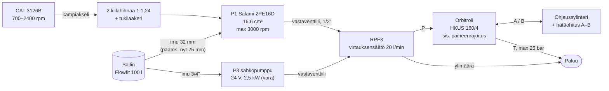
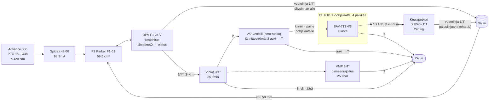
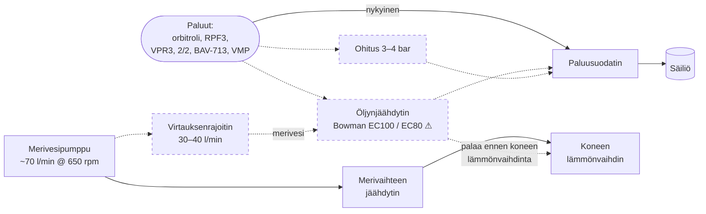

# Hydrauliikan kaavio (suunniteltu kokoonpano)

> **Tila:** päivitetty 2026-10-23 (P2 = F1-61 + BPV, Spidex-kytkin, 50 mm imu). Lohkokaavio suunnitellusta järjestelmästä, ei ISO 1219 -piirrosmerkein.
> Yhtenäinen viiva = olemassa tai päätetty, katkoviiva = suunnitteilla tai vaihtoehto.
> Lähteet ja tarkemmat arvot: [current-system.md](current-system.md),
> [design/p2-pump-options.md](design/p2-pump-options.md), [design/oil-cooling.md](design/oil-cooling.md).
> Vanha kaavio (2018): [img/hydraulics-v3-2018.png](img/hydraulics-v3-2018.png).
>
> **ISO 1219 -kaaviot** (2026-10-23, luonnos): arkki 1 ohjauspiiri, arkki 2 apupiiri ja keulapotkuri,
> arkki 3 paluu, jäähdytys ja säiliö. Alla olevat Mermaid-lohkokaaviot säilyvät yleiskuvana.

## ISO 1219 -kaaviot (luonnos)

Piirretty ISO 1219-1:n piirrosmerkein ja ISO 1219-2:n periaattein: venttiilit lepoasennossa,
komponenttitunnus muotoa *piiri + tyyppi + numero* (P pumppu, M moottori, V venttiili, A toimilaite,
Z muu), osaluettelo alla. **Tila: luonnos, ei rakentamiseen.** Ohjaus on turvallisuuskriittinen:
pätevän henkilön pitää tarkistaa kaavio ennen rakentamista.

### Arkki 1: Piiri 1, ohjaus

| Tunnus | Osa | Tiedot | Lähde |
|---|---|---|---|
| 1M1 | Pääkone CAT 3126B, 2 kiilahihnaa | välitys 1:1,24; kone 700–2400 rpm | [blogi 2017-07-04], [omistaja 2026-10-22] |
| 1P1 | Ohjauspumppu Salami 2PE16D-P28P1 | 16,6 cm³/r, max 3000 rpm, imupaine ≥ 0,7 bar abs, imuaukko 3/4" | [datalehti Salami 2PE], [omistaja 2026-10-23] |
| 1V5 | Imulinjan palloventtiili | täysiaukkoinen, auki ajossa; imu 32 mm (päätös 2026-10-23; nyt 25 mm × 3,2 m) | [p1-steering-pump.md](design/p1-steering-pump.md) |
| 1V7 | P1:n vastaventtiili | ennen T-haaraa, jossa P1 ja P3 yhdistyvät | [omistaja 2026-10-23] |
| 1V1 | Kolmitievirtauksensäätöventtiili Marchesini RPF3 | vakiovirtaus CF 20 l/min orbitrolille pumpun kierroksista riippumatta, ylimäärä EF paluuseen; koko 1/2" [omistaja 2026-10-23] | [datalehti RPF3] |
| 1V2 | Orbitroli M+S HKUS 160/4 | 158,4 cm³/r, avoin keskiasento, ei kuormantakaisinkytkentää; sis. paineenrajoitus 80–170 bar (säädetään käyttöönotossa), iskuventtiilit 140–220 bar; T max 25 bar | [datalehti HKUS] |
| 1V3 | Hätäohitus A↔B | käsiventtiili sylinterin vieressä, lepoasennossa kiinni | [blogi 2017-07-04] |
| 1A1 | Ohjaussylinteri ZS60350100, kaksitoiminen | männän Ø 60 mm, varren Ø 35 mm, isku 100 mm | [omistaja 2026-10-23], [blogi 2017-07-04] |
| 1P2, 1M2 | Varapumppu P3, sähkömoottori 24 V 2,5 kW | kytketty T-haaraan oman vastaventtiilin kautta [omistaja 2026-10-23]; kierrostilavuus **⚠ ei tiedossa** | [blogi 2017-04-01] |
| 1V4 | P3:n vastaventtiili | ennen T-haaraa → RPF3 | [omistaja 2026-10-23] |
| – | Piirin 1 painelinjat | **1/2"** (P1/P3 → RPF3 → orbitroli → sylinteri) | [omistaja 2026-10-23] |
| 1V6 | P3:n imun palloventtiili | imu 3/4" | [blogi 2017-04-10] |
| 1Z1 | Säiliö Flowfit 100 l | 80 l öljyä | [blogi 2017-07-04] |

**Kaaviota piirtäessä esiin tulleet kysymykset:**

- ~~P1:n painelinjan vastaventtiili~~: on olemassa (1V7) ennen T-haaraa [omistaja 2026-10-23].
- Orbitrolin iskuventtiilejä ja imuventtiilejä ei ole piirretty erikseen (orbitrolin sisällä).
- Painelinjat 1/2" [omistaja 2026-10-23]; paluulinjojen koot puuttuvat.

### Arkki 2: Piiri 2, apupiiri ja keulapotkuri

| Tunnus | Osa | Tiedot | Lähde |
|---|---|---|---|
| 2M1 | Advance 300 PTO | 1:1, Ø48 mm kiila-akseli, ≤ 420 Nm; pyörii vastakkaiseen suuntaan kuin kone | [current-system §0](current-system.md), [omistaja 2026-10-23] |
| 2Z3 | Spidex 48/60 -kynsikytkin | hammaskehä 98 Sh A | [päätös 2026-10-23](../decisions.md) |
| 2P1 | Parker F1-61 | 59,5 cm³/r, 350/400 bar; suunta R/L valitaan koneen suunnan mukaan **⚠** | [p2-pump-options](design/p2-pump-options.md) |
| 2V1 | Parker BPV-F1 378 4179, Y1 | jännitteetön = ohitus (pumppu kiertää tyhjänä), käsiohitus; vuotolinja 1/4" suoraan säiliöön; kaaviossa yksinkertaistettu 2/2-venttiilinä | [p2-pump-options](design/p2-pump-options.md#lisävaruste-parker-bpv-f1--ohitusventtiili) |
| 2V0 | Imulinjan palloventtiili | täysiaukkoinen; imu 50 mm, Ø50-imuliitin | [päätös 2026-10-23](../decisions.md) |
| 2B1 | Imupaineanturi | −1…+1 bar, varoitus alle 0 bar | [päätös 2026-10-23](../decisions.md) |
| 2V2 | Marchesini VPR3 3/4" | kolmitie-prioriteettiventtiili, A 35 l/min, ylimäärä B → paluu | [omistaja 2026-10-23], [datalehti VPR3] |
| 2G1 | Painemittari | P-linjassa ennen pohjalaattaa | [blogi 2017-04-01] |
| 2V3 | Marchesini VMP 3/4" | paineenrajoitus 250 bar (säädetään käyttöönotossa); paikka P-linjassa **⚠ tarkista** | [datalehti VMP] |
| 2V4 | Rexroth OD15 2/2, Y2 | omassa rungossaan; jännitteetön auki → T, jännitteellinen kiinni → paine pohjalaatalle | [omistaja 2026-10-23] |
| 2Z2 | Flowfit CETOP 3 -pohjalaatta | 4 paikkaa, 1 käytössä; teräs; painearvo **⚠** | [omistaja 2026-10-22] |
| 2V5 | fluiconnecto BAV-IC3-713, Y3a/Y3b | 4/3, keskiasento P kiinni, A–B–T yhdistetty; 24 V | [omistaja 2026-10-23] |
| 2M2 | Sleipner U11 / SH240 | 100 %: 33,8 l/min, 264 bar; A/B 1/2" SAE 100R2AT 2 × 8,5 m; vuotolinja 1/4" | [ohje Sleipner 2746 35 2025] |

### Arkki 3: Paluu, jäähdytys ja säiliö

| Tunnus | Osa | Tiedot | Lähde |
|---|---|---|---|
| 3E1 | Öljynjäähdytin Bowman EC100 tai EC80 **⚠** | suunnitteilla, ei päätetty; merivesi 25–50 l/min | [oil-cooling](design/oil-cooling.md) |
| 3V1 | Jäähdyttimen ohitusventtiili | 3–4 bar, rinnakkain jäähdyttimen kanssa | [oil-cooling](design/oil-cooling.md#paluulinja-asennus) |
| 3V3 | Merivesihaaran virtauksenrajoitus | 30–40 l/min; vakiovirtausventtiili tai käsiventtiili **⚠ päättämättä** | [oil-cooling](design/oil-cooling.md#merivesi) |
| 3V4 | Kuristus merivesipäälinjaan | ohjaa osan virtauksesta haaraan | [oil-cooling](design/oil-cooling.md#merivesi) |
| 3Z2 | Paluusuodatin | painemittarilla; virtausluokitus **⚠** | [blogi 2017-04-10] |
| 3Z1 | Säiliö Flowfit 100 l | 80 l HVLP 32; uusi 50 mm:n ulosotto P2:lle, 32 mm jää P1:lle | [päätös 2026-10-23](../decisions.md) |
| 3B1 | Öljyn lämpötila-anturi | varoitus 65 °C, hälytys 70 °C → ESP32 / Signal K | [päätös 2026-10-23](../decisions.md) |

**Arkkeja 2 ja 3 piirtäessä esiin tulleet asiat:**

- Vuotolinjat (BPV ja U11) on piirretty suoraan säiliöön öljypinnan alle. BPV:lle Parker vaatii
  tämän; U11:n vuotolinja on nyt paluulinjassa, ja liitoskohta pitää tarkistaa.
- VMP:n paikka P-linjassa (VPR3:n ja 2/2-venttiilin välissä?) **⚠ tarkista**.
- Arkki 2: P2:n lähtöpaineanturia (vaatimuksissa ehdotettu) ei ole piirretty, koska siitä ei ole päätetty.

## 1. Voimansiirto ja ohjauspiiri

## 2. Apupiiri: PTO-pumppu ja keulapotkuri

Pohjalaatan paikat 2–4 ovat vapaana (esim. ankkurivinssi).

## 3. Paluu ja öljynjäähdytys

## Toimintatilat (apupiiri)

| Tila | BPV-F1 | 2/2-patruunaventtiili | BAV-713 | Mitä tapahtuu |
|---|---|---|---|---|
| Ajo | jännitteetön (ohitus) | jännitteetön, auki | keskellä | P2 pyörii mutta kiertää tyhjänä pumpun päädyssä; pieni jäähdytysvirtaus vuotolinjan kautta säiliöön (lämpö **⚠ ei tiedossa**) |
| Keulapotkuri valmiina (tyhjäkäynti) | jännitteellinen (vaihdettu 2/2:n ollessa auki, < 20 bar) | jännitteetön, auki | keskellä | P2:n öljy kiertää matalalla paineella säiliöön (~0,7 kW) |
| Keulapotkuri käytössä | jännitteellinen | jännitteellinen, kiinni | a tai b | Paine nousee pohjalaatalla; VPR3 rajaa virtauksen 35 l/min:iin; potkuri saa ~88 % työntövoimasta (~210 kg) |
| Kierroslukitus (> ~1000 rpm) | pakotetaan jännitteettömäksi (2/2 ensin auki) | pakotetaan jännitteettömäksi | estetty | Pumppu ohitukseen; hälytys, jos syöttö päällä yli ~1200 rpm |
| Sähkökatko | ohitus | auki | keskellä | Keulapotkuri ei toimi; käsiohitus vain kone sammutettuna |

## Avoimia kohtia kaaviossa

- VMP:n fyysinen paikka P-linjassa (VPR3:n P-portin ja pohjalaatan välissä?) **⚠ tarkista**
- ~~2/2-venttiilin paikka~~: omassa erillisessä rungossaan [omistaja 2026-10-23]
- ~~Varapumpun P3 kytkentä~~: P1 ja P3 yhdistyvät T-haarassa kumpikin oman vastaventtiilin kautta RPF3:lle [omistaja 2026-10-23]
- Öljynjäähdytin ja merivesihaara ovat suunnitteilla; iskuventtiileitä ei lisätä (päätös 2026-10-23)
